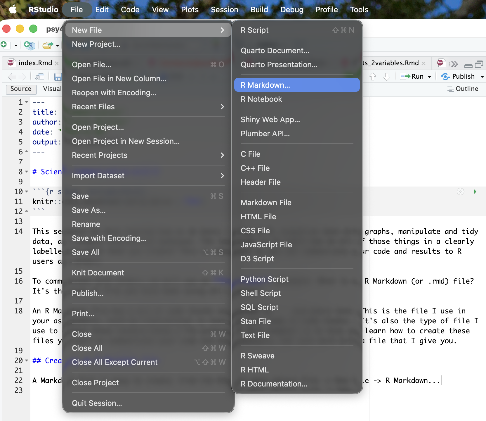
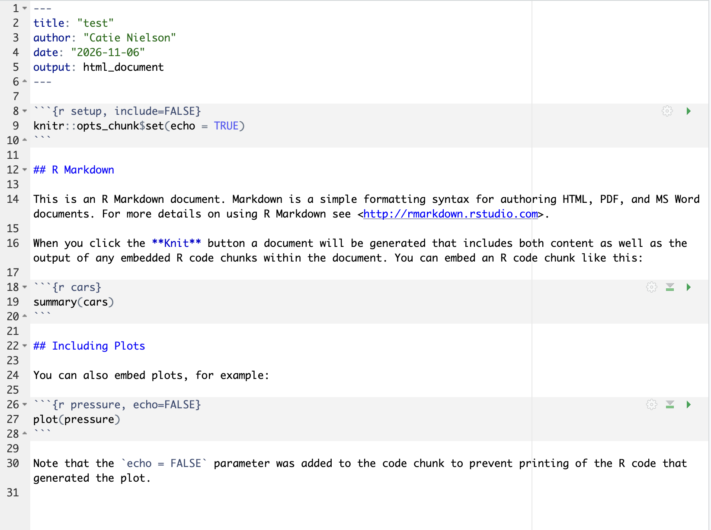
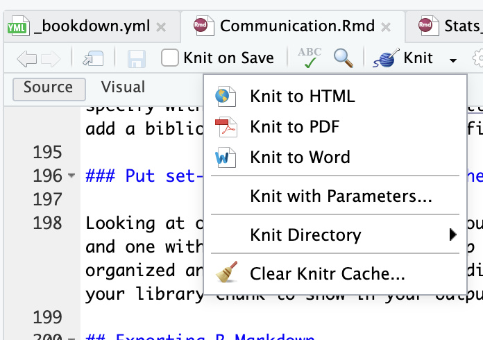

# (PART\*) Science Communication with R {-} 

```{r setup, include=FALSE}
knitr::opts_chunk$set(strip.white = TRUE)
```

```{r echo = FALSE, message=FALSE, warning=FALSE}
library(kableExtra)
library(knitr)
library(palmerpenguins)
library(tidyverse)
```


This semester we have learned how to do basic coding in R, visualize data with graphs, manipulate and tidy data, and conduct statistical analyses. The last step is to learn how do all of those things in a clearly labelled document that you create! This is important so you can communicate your code and results to R users and others.

To communicate with others, we will use an **R Markdown** document. What is an R Markdown (or .rmd) file? It's the type of file you have been using all semester! We actually talked about this way back in the R Basics section on [different types of files]. This is the file I use in your assignments, with my instructions in text and your code in code chunks. (It's also the type of file I use to create these lecture notes.) 

The purpose of this chapter is to help you learn how to create these files yourself to communicate your code and data analysis, not just work with a file that I give you.

## Creating an R Markdown file

A Markdown file is easy to create. From the RStudio menu, select File -> New File -> R Markdown...

{width=100%}

Your new Markdown file will look like this:

{width=100%}

Typically, I delete most of the template lines of code, but you can keep or alter them as you like

As you can see, R Markdown documents have different sections:

1. code chunks in gray boxes  
2. plain text outside the chunks in black. There are also headers and links in blue (we'll discuss how to create those below). 
3. the top of the document has an automatically generated header surrounded by `----` with the title of the document, my name, the data, and the preferred output format.

We'll talk through each of these section types and how to modify them to maximize communication with your audience.

## Code Chunks

As you learned in the [R Markdown Syntax] section, there are different ways to insert a code chunk into your Markdown document. But the important part for the chunk to work it must start with \`\`\`\`{r} without other text or code on the same line and end with \```.

There are few other ways to modify code chunks to improve communication.

### Naming code chunks

Although you don't want to add any other text to the first line of your chunk, you can add a **chunk name** to the `{r}` header within the {}.

```{r code chunk name}

```

This will make it easier for your audience to know what work that particular chunk is doing in your file. For example, you could name a chunk with a graph by its figure number `{r Figure 1}` or title `{r Graph: Penguin Species Frequency by Island}`.

### Code chunk options

Sometimes, you want to modify how a particular code chunk looks in the output (or if it shows up at all!). To do this, we can also modify the `{r}` header with options. The list below is just some of the most common options (taken from [R for Data Science, 1st edition](https://r4ds.had.co.nz/r-markdown.html#text-formatting-with-markdown) aka R4DS); for the full list see http://yihui.name/knitr/options/.

* `eval = FALSE` prevents code from being evaluated. (And obviously if the code is not run, no results will be generated). This is useful for displaying example code, or for disabling a large block of code without commenting each line.

* `include = FALSE` runs the code, but doesn’t show the code or results in the final document. Use this for setup code that you don’t want cluttering your report.

* `echo = FALSE` prevents code, but not the results from appearing in the finished file. Use this when writing reports aimed at people who don’t want to see the underlying R code.

* `message = FALSE` or `warning = FALSE` prevents messages or warnings from appearing in the finished file.

* `results = 'hide'` hides printed output; `fig.show = 'hide'` hides plots.

* `error = TRUE` causes the document to continue to render or knit (more on that below) even if code returns an error. (We have used this before so that R will ignore any fake code that was part of our assignments.) The default, `error = FALSE` causes knitting to fail if there is a single error in the document.

In each case, you would include the option within the `{r}` at the beginning of a code chunk. For example: `{r eval = FALSE}`.

### Formatting code output

You might have noticed in the stats chapters the last few weeks that the default output of statistical tests in R are not very easy to read in the lecture notes. To make a more readable version of this output, or any table, we can use the `kable()` function from the `knitr` package. In this case, I've also used the `tidy()` function from the `broom` package to put the ANOVA output into a format the `kable()` function can use. (This code chunk created with help from Thomas Elton's [RPubs post](https://rpubs.com/tjelton/kable_tables)).

```{r}
library(knitr)
library(broom)

anova_mass <- aov(formula = body_mass_g ~ species, 
    data = penguins)

anova_tidy <- tidy(anova_mass)

kable(anova_tidy, digits = 3, caption = "ANOVA output")
```

### Commenting for communication

Notice that in the last code chunk, you might be able to follow what's happening if you are familiar with these functions, but it's not clearly described. So you might wonder what the `tidy()` or `kable()` function is doing. That problem could be fixed by adding #comments before each section of the code.

```{r}
# Load required packages
library(knitr) # for kable()
library(broom)  # for tidy()

# One-way ANOVA of species on body mass
anova_mass <- aov(formula = body_mass_g ~ species, 
    data = penguins)

# Put ANOVA output into a tidy format that kable() can use
anova_tidy <- tidy(anova_mass)

# Create a nicely formatted table of the ANOVA output
kable(anova_tidy, digits = 3, caption = "ANOVA output")
```

We have used comments throughout the semester for you to communicate to me your interpretation of the code. Now you will use comments to explain to your audience what each part of your code is doing. Comments should be:

1. **Clear**: Describe what the code is doing as clearly and specifically as you can
2. **Concise**: A comment should not go over 1 line. If you feel like you need to make a longer comment, you can break that up by adding a comment to the right of each function (like I did for each `library()` function above).

***Your use of comments is part of your grade for your final project.***

## Text formatting

In addition to code chunks, R Markdown files also allow for plain text sections (like this one!). You can also add headings and links to external sites if needed. Here's how you create different types of text formatting in Markdown (again, taken from [R4DS](https://r4ds.had.co.nz/r-markdown.html#text-formatting-with-markdow)):

```{r error = T}

Text formatting 
------------------------------------------------------------

*italic*  or _italic_
**bold**   __bold__
`code`
superscript^2^ and subscript~2~

Headings
------------------------------------------------------------

# 1st Level Heading

## 2nd Level Heading

### 3rd Level Heading

Lists
------------------------------------------------------------

*   Bulleted list item 1

*   Item 2

    * Item 2a

    * Item 2b

1.  Numbered list item 1

2. The numbers are incremented automatically in the output.

Links and images
------------------------------------------------------------

link: <http://example.com>

link embedded in words: [linked phrase](http://example.com)

image: 

Tables 
------------------------------------------------------------

First Header  | Second Header
------------- | -------------
Content Cell  | Content Cell
Content Cell  | Content Cell
```

### Inline coding

If you want to write a bit of code within a text section, or reference a function or variable name, you can use \`s around that part of the text. So \`filter\` becomes `filter`.

## Best Practices for Organizing R Markdown files

To keep your R Markdown files organized and easy to read, use the following practices:

### Update document header

At the top of your Markdown file, there is a YAML header surrounded by `----`. You should always update this header to include your name, the title of the file, and the date. (Some of you have already practiced this in your weekly assignments!)

You can also add the default output type. For this week, we will use HTML output, which you can specify with `output: html_document` within the header (above the bottom ----). For more customization you can specify with your header, see [R4DS](https://r4ds.had.co.nz/r-markdown.html#yaml-header) (including how to add a bibliography to the end of your file).

### Put set-up and library chunks at the top

Looking at our previous assignments, you'll notice that there is always a code chunk called `{r setup}` and one with libraries in it at the top of the document. This is a best practice for keeping your document organized and communicating to your audience up front which libraries/packages you used. If you don't want your library chunk to show in your output, you can add `echo = F` to the `{r}` section of that chunk.

## Exporting R Markdown

Once you are finished creating your Markdown file, the time has come to create your output! This is called **knitting** and we've discussed it a little bit throughout the semester when you have turned in assignments.

Knitting a document is pretty straightforward. You do it with the yarn ball option at the top of your R Studio screen.

{width=100%}

Notice there are several options for output formats in the knit menu. If you click the **knit** button without clicking on the dropdown arrow, it will automatically generate whatever type of document type you have specified in your header.

There are several types of document types you can knit your Markdown file into. For this week, we will focus on HTML outputs. Here is a list of [other common types](https://r4ds.had.co.nz/r-markdown-formats.html#documents). You can also output your R Markdown document as [presentation slides](https://r4ds.had.co.nz/r-markdown-formats.html#presentations) (feel free to use this for your presentation!). 

Sometimes you might struggle to knit a Markdown file into the document type you want the first time you try. Usually this is because you need to install a package (such as LaTex to knit a PDF). See [this chapter](https://rmd4sci.njtierney.com/common-problems-with-rmarkdown-and-some-solutions) for common troubleshooting steps. (That whole book is great for tips on using R Markdown for science communication!)

## Extras
* [R Markdown cheatsheet](https://opensource.posit.co/resources/cheatsheets/rmarkdown/)

## References
* [R for Data Science, chapers 26-29 on R Markdown](https://r4ds.had.co.nz/communicate-intro.html)
* [R Markdown for Scientists book](https://rmd4sci.njtierney.com/)