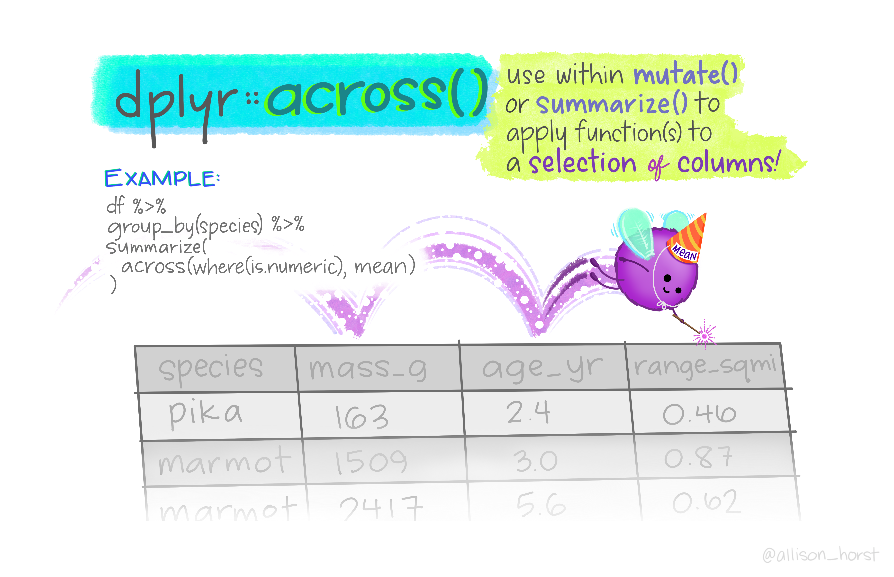

# Summarizing Data

```{r setup, include=FALSE}
knitr::opts_chunk$set(strip.white = TRUE)
```

```{r message=FALSE, warning=FALSE}
library(tidyverse) # Load tidyverse packages
library(palmerpenguins) # Load penguins data
```

```{r echo = FALSE, message=FALSE, warning=FALSE}
library(kableExtra)
library(knitr)
```

Once you have wrangled and subset your data, you may want to compute summary information about that data. There are several quick and flexible ways to do so!

## Table and Count

R has many tools to create quick and easy summaries and descriptive statistics for your data. You saw [previously](#Unique-Entries) how `n_distinct()` could be used to get the number of distinct values for a variable. If you instead want the *number of times* each of those unique values appear in the dataset, you can use `table()` (for a table output) or `count()` (for a dataframe output).

```{r}
penguins %>%
  pull(species) %>%
  table()

penguins %>%
  count(species)
```

### Proportions

If you wanted proportions instead of counts, there are several ways to get that and which method depends on the type of object you are working with (table vs df).

For tables, you simply add `prop.table()` to your pipe chain.

```{r}
penguins %>%
  pull(species) %>%
  table() %>%
  prop.table()
```

For dfs, you have to manually compute the proportions and add them as a new variable.

```{r}
penguins %>%
  count(species) %>%
  mutate(proportion = n / length(penguins$species))
```

::: {.rmdimportant}
**The mutate call here is manually computing the proportion for each unique value of `species`. `n` is a column name generated automatically by `count()`. This is taking the <u>n</u>umber of entries of each unique value and dividing by the total number of ALL entries (which is why the original dataframe's `species` must be used in the `length()` call!).**
:::

When computing proportions, it’s always important you check to make sure you are doing things correctly. If so, they should sum to 1:

```{r}
penguins %>%
  pull(species) %>%
  table() %>%
  prop.table() %>%
  sum()

penguins %>%
  count(species) %>%
  mutate(proportion = n / length(penguins$species)) %>%
  pull(proportion) %>%
  sum()
```

## Summary

If you want a snapshot of your data, you can use `summary()` for a quick quantitative summary of each variable. `summary()` works on a number of different data objects in R. When applied to a dataframe, `summary()` will give you summary statistics on each variable. For categorical variables, it will give a count of each value. For continuous variables, it will give basic summary statistics.

```{r}
summary(penguins)
```

## Summarize

`summary()` works, but is a little messy. You will likely want to be a little more specific with what you want. To get specific summaries of your data, use `summarize()` or `summarise()` (they are the equivalent, just depends on how you like to spell it). `summarize()` has a similar format to `mutate()`, in that you define new variables and how their values are computed. What `summarize()` does is return a new dataframe with one column for each name passed to it, and the value of that column will be the result of the R expression that name is equal to. Consider the example below that uses a subset of the `penguins` data:

```{r echo=FALSE}
penguins_example = penguins %>% 
  rename("flp_mm" = "flipper_length_mm",
         "mass" = "body_mass_g") %>%
  group_by(species) %>% 
  slice(1:2) %>% 
  ungroup() %>%
  select("species", "mass", "flp_mm")
```

```{r}
penguins_example
```

```{r}
penguins_example %>%
  summarize(flipper_m = mean(flp_mm),
            mass_m = mean(mass),
            ratio = mean(mass / flp_mm))
```


```{r echo=FALSE, message=F, warning=F}
Temp = data.frame("ColA" = c(10,11,7,18),
           "ColB" = c(2,5,4,9))

tempTable1 = penguins_example %>%
  kbl() %>%
  kable_paper(full_width = F) %>%
  column_spec(1:ncol(penguins_example), color = "white") %>%
  column_spec(1, background = "lightgrey") %>%
  column_spec(2, background = "#ef6281") %>%
  column_spec(3, background = "#67a9cf") %>%
   kable_styling(bootstrap_options = c("hover", "condensed", "responsive")) %>%
    row_spec(0, bold = T, underline = T, color = "white", align = "c", background = "grey")

Temp2 = penguins_example %>%
  summarize(mass_m = mean(mass),
            flipper_m = mean(flp_mm),
            ratio = mean(mass / flp_mm))

tempTable2 = Temp2 %>%
  kbl() %>%
  kable_paper(full_width = F) %>%
  column_spec(1:ncol(penguins_example), color = "white") %>%
  column_spec(1, background = "#ef6281") %>%
  column_spec(2, background = "#67a9cf") %>%
  column_spec(3, background = "#AB86A8") %>%
   kable_styling(bootstrap_options = c("hover", "condensed", "responsive")) %>%
    row_spec(0, bold = T, underline = T, color = "white", align = "c", background = "grey")

tempTable3 <- data.frame(
  test = c("","")
) %>%
  kbl(booktabs = T) %>%
  kable_paper(full_width = F) %>%
  column_spec(1, image = spec_image(
    c("figures/blank.png", "figures/arrow.png"), 200, 100)) %>%
  row_spec(0, font_size = 0)

kables(list(tempTable1, tempTable3, tempTable2))
```

<!-- ```{r eval=FALSE} -->
<!-- data.frame("ColA" = c(10,11,7,18), -->
<!--            "ColB" = c(2,5,4,9)) -->

<!-- data.frame("ColA" = c(10,11,7,18), -->
<!--            "ColB" = c(2,5,4,9)) %>%  -->
<!--   summarize(meanSum = mean(ColA + ColB),  -->
<!--             meanDif = mean(ColA - ColB)) -->
<!-- ``` -->

<!-- ```{r echo=FALSE, message=F, warning=F} -->
<!-- Temp = data.frame("ColA" = c(10,11,7,18), -->
<!--            "ColB" = c(2,5,4,9)) -->

<!-- tempTable1 = Temp %>% -->
<!--   kbl() %>% -->
<!--   kable_paper(full_width = F) %>% -->
<!--   column_spec(1:ncol(Temp), color = "white") %>% -->
<!--   column_spec(1, background = "darkgray") %>% -->
<!--   column_spec(2, background = "lightgray") %>% -->
<!--    kable_styling(bootstrap_options = c("hover", "condensed", "responsive")) %>% -->
<!--     row_spec(0, bold = T, underline = T, color = "white", align = "c", background = "gray") -->

<!-- Temp2 = Temp %>%  -->
<!--   summarize(meanSum = mean(ColA + ColB),  -->
<!--             meanDif = mean(ColA - ColB)) -->

<!-- tempTable2 = Temp2 %>% -->
<!--   kbl() %>% -->
<!--   kable_paper(full_width = F) %>% -->
<!--   column_spec(1:ncol(Temp), color = "white") %>% -->
<!--   column_spec(1, background = "darkgray") %>% -->
<!--   column_spec(2, background = "lightgray") %>% -->
<!--    kable_styling(bootstrap_options = c("hover", "condensed", "responsive")) %>% -->
<!--     row_spec(0, bold = T, underline = T, color = "white", align = "c", background = "gray") -->

<!-- tempTable3 <- data.frame( -->
<!--   test = c("","") -->
<!-- ) %>% -->
<!--   kbl(booktabs = T) %>% -->
<!--   kable_paper(full_width = F) %>% -->
<!--   column_spec(1, image = spec_image( -->
<!--     c("figures/blank.png", "figures/arrow.png"), 200, 100)) %>% -->
<!--   row_spec(0, font_size = 0) -->

<!-- kables(list(tempTable1, tempTable3, tempTable2)) -->
<!-- ``` -->

<!-- Above, the name of one column is `meanSum`, and its value is `mean(ColA + ColB)`. `ColA` and `ColB` are vectors that were added together, so the first value of each is summed, then the second….ith, then you take the mean of that new set of numbers. It should come as no surprise then that summary is designed to work with summary functions -- those that output a single value. -->

Above, the name of one column is `flipper_m`, and its value is the mean of the `flp_mm` variable. Likewise, the `mass_m` column is the mean of the `mass` variable. The third variable, `ratio`, is `mean(mass / flp_mm)`. `mass` and `flp_mm` are vectors a quotient was computed for, so the quotient of the first value of each is found, then the second… ith, then the mean of that new set of numbers is taken. It should come as no surprise then that summary is designed to work with summary functions -- those that output a single value.

To verify if that this is true:

```{r}
firstCol = c(181, 186, 192, 196, 211, 230)
mean(firstCol)
secondCol = c(3750, 3800, 3500, 3900, 4500, 5700)
mean(secondCol)
thirdCol = c(3750/181, 3800/186, 3500/192, 3900/196,
             4500/211, 5700/230)
mean(thirdCol)
```

## Grouping Data

The power of `summarize()` comes from pairing it with `group_by()`. `group_by()` organizes your data into subgroups based on shared values. Compare the output of the following:

```{r}
penguins %>%
  glimpse()

penguins %>%
  class()
```

```{r}
penguins %>%
  group_by(species) %>%
  glimpse()

penguins %>%
  group_by(species) %>%
  class()
```

There are two things to note here. First, these two are slightly different classes. Applying `group_by()` converts your object to a grouped dataframe/tibble, which basically just denotes that the data is organized into subgroups. Second, the additional line in the second output: `Groups: species [3]`, denotes what that grouping is. There are 3 unique species in this dataset, so this line says each `species` value is separated into its own group and there are 3 of those groups. A df can be grouped by a single or multiple variables.

### Grouped Summaries

`group_by()` allows you to perform operations group-wise and helps unlock to true power of `summarize()`. It tells R that you want to analyze your data separately according to the different levels of some grouping variable that you specify. The following example will again use a subset of the `penguins` data:

```{r eval=FALSE}
penguins_example %>%
  group_by(species) %>%
  summarize(m = mean(flp_mm))
```

```{r echo=FALSE}
penguins %>% 
  rename("flp_mm" = "flipper_length_mm") %>%
  group_by(species) %>% 
  slice(1:2) %>%
  summarize(Flp_m = mean(flp_mm))
```


```{r echo=FALSE, message=F, warning=F}
Temp = penguins %>% 
  rename("flp" = "flipper_length_mm") %>%
  group_by(species) %>% 
  slice(1:2) %>%
  select(species, flp)

tempTable1 = Temp %>%
  kbl() %>%
  kable_paper(full_width = F) %>%
  column_spec(1:ncol(Temp), color = "white") %>%
  row_spec(1:2, background = "#FF3399") %>%
  row_spec(3:4, background = "#0000FF") %>%
  row_spec(5:6, background = "#336600") %>%
  kable_styling(bootstrap_options = c("hover", "condensed", "responsive")) %>%
  row_spec(0, bold = T, underline = T, color = "white", align = "c", background = "gray")


Temp3 = penguins %>% 
  rename("flp" = "flipper_length_mm") %>%
  group_by(species) %>% 
  slice(1:3) %>%
  ungroup() %>%
  slice(-9) %>%
  select(species, flp)

tempTable2 = Temp3 %>%
  kbl() %>%
  kable_paper(full_width = F) %>%
  column_spec(1:ncol(Temp), color = "white") %>%
  row_spec(1:2, background = "#FF3399", align = "c") %>%
  row_spec(4:5, background = "#0000FF", align = "c") %>%
  row_spec(7:8, background = "#336600", align = "c") %>%
  row_spec(c(3,6), font_size = 0) %>%
  row_spec(0, bold = T, underline = T, color = "white", align = "l", background = "gray") %>%
  pack_rows("species______flp", 4, 5, 
            label_row_css = "background-color: gray; color: #fff;", 
            underline = T, ) %>%
  pack_rows("species______flp", 7, 8, 
            label_row_css = "background-color: gray; color: #fff;", underline = T, ) %>%
  kable_styling(bootstrap_options = c("hover", "condensed", "responsive"))

# tempTable2 = Temp %>%
#   kbl() %>%
#   kable_paper(full_width = F) %>%
#   column_spec(1:ncol(Temp), color = "white") %>%
#   row_spec(1:2, background = "#FF3399", align = "c") %>%
#   row_spec(3:4, background = "#0000FF", align = "c") %>%
#   row_spec(5:6, background = "#336600", align = "c") %>%
#   row_spec(0, bold = T, underline = T, color = "white", align = "l", background = "gray") %>%
#   pack_rows("species______flp", 3, 4, 
#             label_row_css = "background-color: gray; color: #fff;", 
#             underline = T, ) %>%
#   pack_rows("species______flp", 5, 6, 
#             label_row_css = "background-color: gray; color: #fff;", underline = T, ) %>%
#   kable_styling(bootstrap_options = c("hover", "condensed", "responsive"))

Temp2 = penguins %>%
  group_by(species) %>%
  slice(1:2) %>%
  summarize(flp_m = mean(flipper_length_mm))

tempTable4 = Temp2 %>%
  kbl() %>%
  kable_paper(full_width = F) %>%
  column_spec(1:ncol(Temp), color = "white") %>%
  row_spec(1, background = "#FF3399") %>%
  row_spec(2, background = "#0000FF") %>%
  row_spec(3, background = "#336600") %>%
  kable_styling(bootstrap_options = c("hover", "condensed", "responsive")) %>%
  row_spec(0, bold = T, underline = T, color = "white", align = "c", background = "gray")


tempTable3 <- data.frame(
  test = c("","")
) %>%
  kbl(booktabs = T) %>%
  kable_paper(full_width = F) %>%
  column_spec(1, image = spec_image(
    c("figures/blank.png", "figures/arrow.png"), 200, 100)) %>%
  row_spec(0, font_size = 0)

kables(list(tempTable1, tempTable3, tempTable2, tempTable3, tempTable4))
```

Put a different way, when `summarize()` gets passed a grouped df, it will:

1. Treat all groups of data as though they are a distinct dataset
2. Apply the code to each group individually, resulting in separate summary statistics for each
3. Combine the results into a new data frame.

You see can this process illustrated in the figure above.

<p class="text-info"> **Note: When you are not using `summarize()`, it is very important to remember to `ungroup()` your data when you are finished. Otherwise, subsequent functions will be unintentionally applied to individual groups rather than the entire dataset! This is not relevant when using `summarize()` because the resulting output will be a new dataframe.**</p>

`summarize()` has some handy functions it easily works with. For example `n()` will give you the number of values in the vector. This is particularly useful to find the number of observations in different groups:

```{r}
penguins %>%
  group_by(island, species) %>%
  summarize(n = n())
```

::: {.rmdimportant}
**This first groups by `island` then `species` within `island`, and finds the number of observations for each. From the output, you can see that not all islands have observations from each species. In fact, some islands only contain obsercvations from a single species!**
:::


## Using `across()` with `summarize()`

{width=100%}

In lieu of manual specification, you can use `across()` within a `summarize()` call and make use of all the [helper functions](#helper-functions) introduced previously. This allows you to perform computations over several columns at once! For example, if you wanted to get grouped means on all the bill related variables, instead of calling `mean(x)` on each individually, like this:

```{r}
penguins %>%
  drop_na() %>%
  group_by(species) %>%
  summarize(bill_length_mean = mean(bill_length_mm),
            bill_depth_mean = mean(bill_depth_mm))
```

you could do the following:

```{r}
penguins %>%
  group_by(species) %>%
  summarize(across(starts_with("bill"),
                   mean, na.rm = TRUE))

# penguins %>%
#   group_by(species) %>%
#   summarize(across(starts_with("bill"), ~ mean(.x, na.rm = TRUE)))

# ^Long form of the same thing.
```

<p class="text-info"> **Note: Instead of using `drop_na()`, the `na.rm` argument was used. These both accomplish the same thing.**</p>

You can perform multiple summary functions at the same time by passing them as a list rather than just the function name:

```{r}
penguins %>%
  group_by(island) %>%
  summarize(across(starts_with("bill"), 
                   list(mean = mean, sd = sd), na.rm = TRUE))
```

As another example, say you wanted to find the number of unique levels for the different factors in your data. This could be done on the entire dataset:

```{r}
penguins %>%
  drop_na() %>%
  summarize(across(where(is.factor), n_distinct))
```

Or by a grouping variable:

```{r}
penguins %>% 
  drop_na() %>%
  group_by(species) %>% 
  summarize(across(where(is.factor), n_distinct))
```

The combination of `group_by()`, `summarize()`, and `across()`, allow for some quick and powerful code that is relatively short. In just a few lines above, you were able to get some very specific and nuanced information about this dataset!

## Row-wise operations

You might imagine a scenario where instead of wanting a summary or mean for the entire dataset, you need a summary for each observation. For example, if you wanted to create one score that took the average across several columns. This can't be done with `across()` because that will summarize each column separately. One option for this is to combine `rowwise()`, which applies a function to each row, with `summarize()`.

```{r}
penguins_new <- penguins %>%
  rowwise() %>%
  summarize(bill_mean = mean(c(bill_length_mm, bill_depth_mm)))

head(penguins_new)
```

Uh oh, that didn't do what we wanted. Instead it reduced the dataframe to just our new column. Unfortunately, that is always how summarize works. But another option is to combine `rowwise()` with `mutate()` instead of `summarize()`.

```{r}
penguins_new <- penguins %>%
  rowwise() %>%
  mutate(bill_mean = mean(c(bill_length_mm, bill_depth_mm)), .before = bill_length_mm)

head(penguins_new)
```

There we go! If you don't want to type out all the column names (and you've named your columns well!), you can  combine `mutate()` with `pick()`, which acts like a selecting function inside of mutate, and `rowMeans()` (which is another way to find the mean by row instead of combining `mean()` and `rowwise()`).

```{r}
penguins_new <- penguins %>%
  mutate(bill_mean = rowMeans(pick(starts_with("bill")), na.rm = T), .before = bill_length_mm)

head(penguins_new)
```


## Extra Resources

* dplyr documentation for [row-wise](https://dplyr.tidyverse.org/articles/rowwise.html) and [column-wise](https://dplyr.tidyverse.org/articles/colwise.html) operations
* [across](https://dplyr.tidyverse.org/reference/across.html) documentation
* [data wrangling cheatsheet](https://rstudio.com/wp-content/uploads/2015/02/data-wrangling-cheatsheet.pdf)