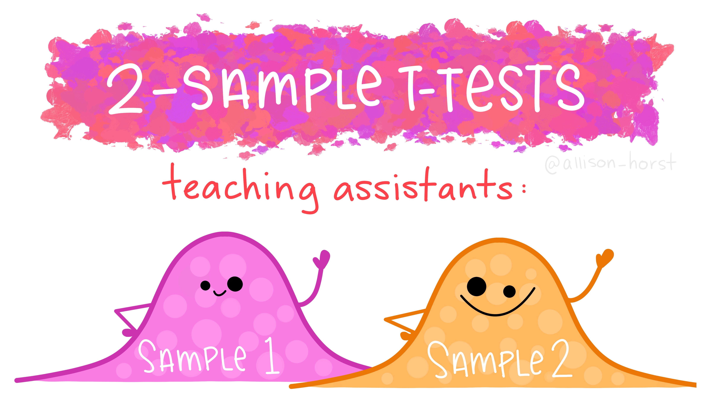
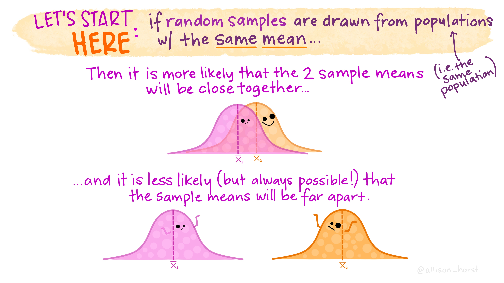
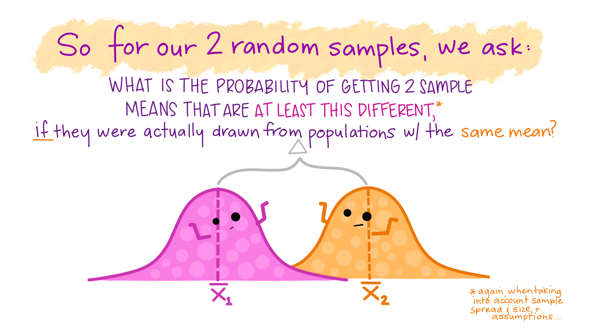
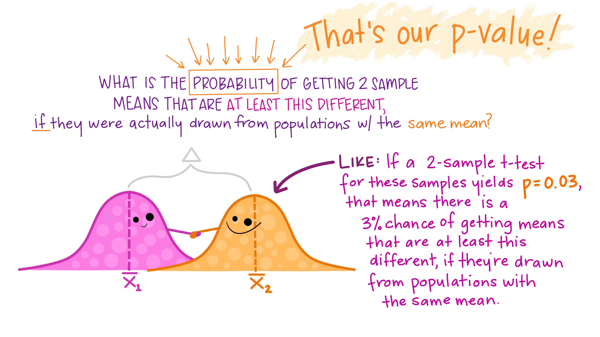

---
output:
  pdf_document: default
  html_document: default
---

# Statistical Analysis with Two Variables

```{r setup, include=FALSE}
knitr::opts_chunk$set(strip.white = TRUE)
```

```{r echo = FALSE, message=FALSE, warning=FALSE}
library(kableExtra)
library(knitr)
library(palmerpenguins)
library(rstatix)
library(tidyverse)
```

In this chapter, we will cover three main statistical tests for analyses with two variables: chi-square, correlation, and t-test.

## Two categorical variables: Chi-square test

When both your predictor and outcome variables are categorical, the statistical test we will use is the chi-square test of independence. Very simply put, this test allows us to examine if there is an association between two categorical variables by comparing the *expected counts* within each group (all things being equal) to the *actual counts*. If you want more of an explanation of this test, check out the [whole chapter](https://learningstatisticswithr.com/12-chisquare.html) on chi-square and related tests in LSWR. Chi comes from the Greek letter and mathematical symbol $\chi$, square because of how this test statistic is calculated.

To think about how this test works and how to interpret it, let's look at an example from the penguins dataset.

In our visualization section, we made a graph to answer the question, "what is the distribution of penguin species on each island?" It looked like this:

```{r}
# color
penguins %>%
  ggplot(aes(x = island, fill = species)) + 
  geom_bar(position = position_dodge())

```

As you can see, there are different numbers of each penguin species on each island and no island has all types of penguins. But how can we determine if this differences is **statistically significant**? We can use a chi-square test!

First, we need to decide on our statistical hypotheses. For a chi-square test, the ***null hypothesis*** is usually that the two variables are not related (hence, the test of independence). In other words, the count should be the same for each group. So in this case, the null hypothesis is that there are an *equal* number of penguins of each species on each island. The ***alternative hypothesis*** is that the two variables are related (not independent) or that there are an *unequal* number of each species on each island.

### Calculating a chi-square test in R

Now that we know the hypotheses the test will be comparing, we can run the test. In R, we can use the built in `stats` package to run most of our statistical tests. However, this package doesn't play well with the tidyverse, so if you want to put a statistical test onto the end of a pipe chain (after some mutating and filtering, for example) you'll use a different package (see the end of the this chapter).

The function we will use is `chisq.test()` which takes the inputs x and y for our two variables. In this case, x and y are two columns in the dataframe, so I can call them using column indexing (in this case, $).

```{r}
chisq.test(x = penguins$species, penguins$island)
```

### Interpreting a chi-square test

How exciting, your first statistical test in R! But what does it mean?

As you can see, there are three numerical outputs from this test, just like I promised last chapter: 1) **a test statistic** (X-square where X = chi), 2) **degrees of freedom**, and 3) a ***p*-value**. 

The test statistic is very large, so that means there is a large effect (yay!). The degrees of freedom is small because for chi-square tests it is based on the number of groups (islands and species), not the number of observations (penguins). 

Then looking at the p-value, it is written in scientific notation, so this means that *p* < 2.2 x $10^{-16}$. For those of you who don't like scientific notation, that is *p* < 0.00000000000000022 (basically 0). This is much, much smaller than 0.05, so we can say that this result is statistically significant, reject the null hypothesis, and conclude that there is an unequal number of penguins in each species on each island. In other words, your conclusion based on your graph was statistically supported!

However, the output of a chi-square test doesn't tell us **how** that the null hypothesis is wrong, just that it is not supported. In other words, this output doesn't tell us which island has which penguin species. For that, we need a table of counts (like the ones you practiced making last week!).

```{r}
penguins %>%
  group_by(island, .drop = F) %>%
  count(species) %>%
  ungroup() %>%
  mutate(total = sum(n))
```
*Note that I have included the input `.drop = F` in the `group_by()` function so that we can see the cells where there are 0 penguins of a certain species on each island.*

Or, if you want to make it look more like a traditional table, you can use the `xtabs()` function
from the stats package. You'll notice in this function that you input a formula instead of an x and y separately. A formula input is set up like an equation, where the ~ represents an equals sign. This may not make a lot of sense here, but we'll discuss it more later on.

```{r}
xtabs(formula = ~ island + species, data = penguins)
```

No matter how you make your table, you can see that there are distinct distributions of penguins on each island. Biscoe island has Adelie and Gentoo penguins, but not Chinstrap. Dream island has Adelie and Chinstrap, but not Gentoo. And Torgersen island has only Adelie penguins. Or, put another way, Adelie penguins are on all three islands, whereas Chinstrap are only on Dream island and Gentoo are only on Biscoe.

### Reporting a chi-square test

As a reminder from the previous chapter, we can use these 4 steps to report a statistical test and result:

1. Describe the statistical analysis you performed.
2. Tell whether the result is statistically significant.
3. Present the statistical results or outputs (the test statistic, p-value, degrees of freedom, etc.).
4. Describe the relation in the context of your hypothesis and variables.

You can report the statistical results of a chi-quare test result using the following template: "X and Y were [not] significantly related, ($\chi^2$(a, N=b)=c, *p*=d)."

X, Y: variables being compared

a: Degrees of freedom for the Chi-square test

b: total number of observations (you can find this by adding a `total` column to your frequency table, as I did above, or just looking at how many observations are in your dataset)

c: Chi-square value

d: p-value for the effect

:::{.rmdimportant}
Using this to report the results of the chi-square test above, you could say: 
"(1) We analyzed whether penguin species and island were independent of one another using a Chi-Square test of independence.(2 & 3) A significant relationship between island and penguin species was found ($\chi^2$(2, N=344) = 299.55, *p* < 0.0001). (4) These results suggest that which penguin species were present varied from island to island. Adelie penguins were found on all three islands, whereas Chinstrap were only found on Dream island and Gentoo were only on Biscoe (see Table 1).”
:::

Notice a few things about this report of statistical results. First, steps 2 and 3 of our reporting template were in the same sentence. This is typical, since you usually do not need a separate sentence just for the numerical results and you can just include them in a parenthesis, as you see here. For a chi-square test you also do not need to interpret the test statistic or chi-square value; it's enough just to report it and interpret it as you do in step 4. 

Second, you might notice that I didn't write out the scientific notation with the very small p-value. Instead, I just said that *p* < 0.0001. That's just because anything smaller than that is a highly reliable effect, so the exact p-value doesn't really matter. 

Finally, for a chi-square test, you do need to provide additional context in step 4 in the form of a count table (here referred to in the text as Table 1), not just the output of the test. Again, that is because the test tells you if there is a relationship or not, but not the direction or content of that relationship. You can only get that information from a count table.

### Non-significant results

But what if your chi-square test does not produce a significant result? For example, let's consider the research question: "is there an association between species and sex of the penguins?" (It would be a problem if there were more male penguins of one species than females.)

```{r}
chisq.test(penguins$sex, penguins$species)
```

Comparing this *p*-value to 0.05, it is much larger. That means our result is not significant. Which is this case is a good thing, there is not a roughly equal number of male vs. female penguins in all three species.

```{r}
xtabs(formula = ~ sex + species, data = penguins)
```

So how would we report these results? Using the same 4 steps as for significant results!

:::{.rmdimportant}
We analyzed whether penguin species and sex were independent of one another using a Chi-Square test of independence. There was not a significant relationship between sex and penguin species ($\chi^2$(2, N=333) = 0.048607, *p* = 0.976). These results suggest that there is an equal number of penguins of each sex for each species. You can see this in Table 1; there were an equal number of male and female penguins for the Adelie and Chinstrap species, and nearly equal for Gentoo penguins.
:::

*(Note: the total N changed because we dropped penguins without a sex.)*

## Two continuous variables: correlation

When both your predictor and outcome variables are continuous, the statistical test to use is a **correlation**. In this class, we will use **Pearson's r** correlations, although there are other types (see [LSWR](https://learningstatisticswithr.com/05-descriptives.html#spearmans-rank-correlations)). Like chi-square tests of independence, correlations express the relationship between two variables. However, since the variables are continuous, this relationship is not measured through counts or frequencies, but with a **linear relationship**. While the calculation for a Pearson's r correlation does not match exactly with the slope of a line (that would be a regression, and we'll talk more about those next week), it does tell us about the strength and the direction of the relationship between our two variables. 

As an example of a research question that would use a correlation, consider another graph from the Visualization section showing the relationship between body mass (in grams) and flipper length (in millimeters) among penguins in the Palmers Penguins dataset:

```{r message = F, warning = F}
penguins %>%
  ggplot(aes(y = body_mass_g, x = flipper_length_mm)) +
  geom_point() +
  geom_smooth(method = 'lm', se = FALSE)
```

Looking at this graph and its trendline, it seems pretty obvious that there is a strong, positive relationship between body mass and flipper length. But to be sure, we need to calculate the correlation.

### Calculating a correlation in R

To calculate a correlation, you can use the `cor()` function from the stats package. You can also specify the method as "pearson", or you can leave it blank because Pearson's r is the default. `use = "complete.obs"` tells R to only use **complete obs**ervations (that is, to remove NAs).

```{r}
cor(x = penguins$body_mass_g, 
    y = penguins$flipper_length_mm, 
    method = "pearson", 
    use = "complete.obs")
```

Great! We calculated a correlation, *r* = 0.87, which seems to match our prediction that there is a strong positive relationship between our two variables. Hooray! But how do we know if this relationship is statistically significant? Where is the p-value?

It turns out that calculating a correlation does not automatically provide information about statistical significance because it's not a comparison between groups or hypotheses like a chi-square test. To calculate a p-value and determine significance, we need to use a function with a hypothesis test built in: `cor.test()`.

Before we run the test though, let's think about what the statistical hypotheses are for the analysis. For hypothesis testing with a correlation, the null hypothesis is typically that there is no relationship between our variables, or *r* = 0. A non-directional alternative hypothesis would that there is a relationship, *r* $\neq$ 0 (two-tailed test). If you think the relationship will be positive your alternative hypothesis would be *r* > 0, if negative then *r* < 0 (in either case, a one-tailed test). So our `cor.test()` function will be comparing the r value you calculated above (using `cor()`) to a correlation of 0.

For a two-tailed test or non-directional alternative hypothesis we would write:

```{r}
cor.test(x = penguins$body_mass_g, 
         y = penguins$flipper_length_mm, 
         method = "pearson", 
         use = "complete.obs",
         alternative = "two.sided")
```

Nice! So now you have your r value, but also a p-value and degrees of freedom (df). Interestingly, you also have a t-value and a 95% confidence interval. That's because the comparison that R is doing on the back end to get this result is a t-test (we'll review those below).

If you wanted to test a directional hypothesis--let's say you think that there will be a positive relationship between body mass and flipper length--then you would use a one-tailed test with the alternative hypothesis of "greater" than 0.

```{r}
cor.test(x = penguins$body_mass_g, 
         y = penguins$flipper_length_mm, 
         method = "pearson", 
         use = "complete.obs",
         alternative = "greater")
```

### Interpreting a correlation

Interpreting a correlation involves two things: 1) interpreting the size and direction of the relationship based on the r-value, and 2) determining whether the effect is significant or not using the p-value.

Simply put, r can be any value from -1 to 1. ***Direction*** of the relationship is indicated by the **sign** of the r value, positive or negative. A positive r value indicates a positive relationship between two variables (as one increases, the other *increases*). A negative r value indicates a negative or inverse relationship between two variables (as one increases, the other *decreases*). 

***Strength*** of the relationship is indicated by the absolute **size** of the r value, positive or negative. Where a specific r value is considered strong or weak depends a lot on the field you are in and the relationship you expect based on past research. You will see a lot of different rules out there for what to call a "small" vs. a "large" r value! For this class, we will use these cut-offs, which are relatively standard in psychology (see the "Traditional/Popular cutoffs for Effect Sizes" in [this paper](https://pmc.ncbi.nlm.nih.gov/articles/PMC8210805/)).

```{r echo = F}
df <- data.frame(
  rvalue = c("0.1 - 0.29", "0.3 - 0.49", "0.5 - 1"),
  size = c("small", "medium", "large")
)

df %>%
  kable(format = "html", col.names = c("Pearson's r", "Effect size"), escape = F) %>%
  kable_styling(bootstrap_options = c("striped", "hover", "condensed"), full_width = FALSE)
```

So given our finding that *r* = 0.87, we would conclude that there is a strong, positive relationship between body mass and flipper length because the correlation is positive and the value is greater than 0.5. *(Note: if the value was -0.87, this would still be a strong relationship, just in the negative direction.)*

As with the chi-square test above, to interpret the p-value, we would compare it to *p* = 0.05. In this case, the p-value for the two-sided test is *p* = 2.2 * $10^{-16}$, which is less than p = 0.05. So we would conclude this result is statistically significant.

### Reporting a correlation

You can present the statistical output of a correlation using the following template:

"X and Y were [not] significantly correlated (r=a, p=b)."

X, Y: Independent variables for which you observe significant effects

a: Correlation

b: p-value for correlation

You can also report the t-test and degrees of freedom, but you don't have to. It depends on the standards of your professor or journal editor (if you are submitting for publication). In this class, you don't need to report them.

:::{.rmdimportant}
So to report the two-tailed correlation test above, you could say: "We examined the relationship between a penguin's body mass (in grams) and their flipper length (in millimeters) using a Pearson's r correlation. These variables showed a strong, positive, and significant correlation (*r* = 0.97, *p* < 0.0001). Among these penguins, as body mass increased, so did flipper length."
:::

### Non-significant results

If your correlation test does not produce a significant result, we can follow a similar pattern for interpreting and reporting it as for non-significant results from a chi-square test. To explore this, let's consider a research question using the `mtcars` dataset: "is there a relationship between horsepower and number of gears in a car?"

```{r}
cor.test(mtcars$hp, mtcars$gear)
```

This *p*-value is larger than our cut-off of 0.05, so our result is not significant. We can report this result as follows:

:::{.rmdimportant}
We examined the relationship between a car's horsepower and the number of its gears using a Pearson's r correlation. There was not a significant correlation (*r* = -0.13, *p* = 0.493). A car's horsepower is not related to how many gears it has.
:::

## Categorical predictor & Continuous outcome: t-test

If you have a categorical predictor with two groups and a continuous outcome, the statistical test to use is called a two-sample ***t-test***. *(There are also one-sample t-tests which we will not cover in the course, though see [LSWR](https://learningstatisticswithr.com/13-ttest.html#sec-onesamplettest) for an overview.)* Most often, you will use an independent samples t-test, because the two groups you are comparing contain different people or independent observations (between-subject design). However, if you are comparing scores from the same people or dependent observations (within-subject design), you will need to use a paired-samples t-test.

Like a chi-square test, a t-test compares two different groups (sample 1 and sample 2). However, instead of comparing counts or frequencies between groups, a t-test compares the **mean** of each group (based on the continuous variable).

{width=100%}
<p style="font-size:6pt">Finally, the return of Allison Horst's fun illustrations!</p>

Before we calculate the test, let's think about our statistical hypotheses. The ***null hypothesis*** is typically that there is no difference between the means.

{width=100%}

Like the other tests, the alternative hypothesis can be either directional (one-tailed) or non-directional (two-tailed). A ***non-directional alternative hypothesis*** would be that there is any difference at all, either positive or negative (two-tailed test). For a ***directional alternative hypothesis***, you could state that you expect the mean of one group to be higher or lower than the other (in either case, a one-tailed test). We'll look at both one-tailed and two-tailed tests in the next section.

For practicing t-tests, we'll use another example from the penguins dataset, in this case answering the research question, "is there a difference in body mass between male and female penguins?" Here's a graph of this data (notice I've removed the penguins without a sex [sex = NA].)

```{r}
penguins %>%
  drop_na(sex) %>%
  ggplot(aes(y = body_mass_g, x = sex)) +
  geom_jitter(aes(color = sex), width = 0.2) +
  geom_violin(aes(color = sex), alpha = 0.2) +
  stat_summary(fun.data = "mean_se", geom = "pointrange") +
  coord_cartesian(ylim = c(0,7000))
```

It looks like there is probably a difference of means, such that male penguins weigh more than female penguins. But there is also a lot of overlap in the body mass measurements between the two groups. 

{width=100%}

Let's test it!

### Calculating a t-test in R

To calculate a t-test in R we can use the `t.test()` function from the stats package. *(Note that this test defaults to a Welch's two-sample t-test, so if you want to use a student's t-test, which has different assumptions, you need to add the argument `var.equal = T`. See [LWSR](https://learningstatisticswithr.com/13-ttest.html#doing-the-test-in-r-1) for details.)* There are two ways to input the data: 1) if your data points are in separate columns and 2) if you have a column for the data and a column for the groups. Our data is currently set up with a data column (body_mass_g) and a group column (sex), so we will first show how the test can be done with this set up. 

#### One column for data, one column for group

This set up uses a *formula* input, similar to the correlation input you saw above. We'll start with the two-tailed test with the alternative hypothesis that there is a difference in body mass between sexes, but we aren't specifying a direction. 

```{r}
t.test(formula = body_mass_g ~ sex, 
       data = penguins,
       alternative = "two.sided")
```

Like the other tests, this output gives us a test statistic (*t*), degrees of freedom, and a *p*-value. You can also see a statement of the two-tailed alternative hypothesis, 95% confidence interval, and the means for each group. We'll walk through how to interpret those below. 

Before that, let's run this again but with one-tailed, directional alternative hypothesis: that male penguins have a higher body mass than female. But do we put "greater" or "less" as our alternative hypothesis? 

Well, it depends on the direction that R does the comparison: male > female or female < male. To decide this, we first need to check the order of the levels (female and male) in the factor `sex`.

```{r}
levels(penguins$sex)
```

Ok, so since female is listed first, that is the first level in our factor and the one the other level is compared to. Think of this like female is 0 and male is 1. R will make the comparison with female first, so our alternative hypothesis should be written female < male, or "less".

```{r}
t.test(formula = body_mass_g ~ sex, 
       data = penguins,
       alternative = "less")
```

In this output, we can see the alternative hypothesis that R used: "true difference in means between group female and group male is less than 0". This result looks very different than if we specified the alternative as "greater". Specifically, look at the change in p-value.

```{r}
t.test(formula = body_mass_g ~ sex, 
       data = penguins,
       alternative = "greater")
```
#### Two columns for data

Ok, but what if you have two different columns or variables to compare, instead of one variable split into two groups? For example, imagine that you have two body mass columns, one for males and one for females.

```{r}
penguins_pivot <- penguins %>%
  pivot_wider(names_from = sex, values_from = body_mass_g) %>%
  select(male, female)

head(penguins_pivot)
```

Now instead of using a formula, I can just specify one column as x and one as y.

```{r}
t.test(x = penguins_pivot$male, 
       y = penguins_pivot$female,
       alternative = "two.sided")
```

As you can see, this gives us the same output as the test with a formula. If you wanted to run a one-tailed directional hypothesis using this method, you would choose either "greater" or "less" as the input. Deciding on the direction is a little easier than for the formula method because R will always put the variable you specify as x first. So if I have x = male, then "greater" would mean male > female and "less" would mean male < female.

#### Paired samples t-test

If you are comparing two non-independent groups (like a within-subjects or pre/post design), all you have to do is add the argument `paired = T` to your `t.test()` function. See [LSWR](https://learningstatisticswithr.com/13-ttest.html#sec-pairedsamplesttest) for more information on the paired samples t-test and it's interpretation.

### Interpreting a t-test

Ok, let's return to the output of our first test to try and interpret it.

```{r}
t.test(formula = body_mass_g ~ sex, 
       data = penguins,
       alternative = "two.sided")
```

First, we can see that our *t*-value is negative and different from 0. A negative t-value indicates that the mean for group 1 (in this case "female" based on how our factor is set up) is less than our mean for group 2 (male). And when we look at the means at the bottom of the output, we can see this is the case: female penguins weigh about 3862 grams on average, while male penguins weight about 4546 grams. 

The degrees of freedom is 323.9 (which is weird because it's not a whole number, but sometimes this happens based on how the df is calculated), which is the total number of penguins (344) minus whatever we calculated for out constraints.

As usually, we interpret our *p*-value by comparing it to the cut-off of *p* = 0.05. Once again, this *p*-value is much, much smaller than 0.05, so we can conclude that this result is statistically significant.

{width=100%}

### Reporting a t-test

You can report the statistical result of a t-test using the following template:

"X and Y were [not] significantly different, (*t*(a)=b, *p*=c)."

X, Y: groups being compared

a: degrees of freedom (df) for the t-test

b: *t*-value

c: *p*-value

:::{.rmdimportant}
To report our result from the analysis above, you could say: "We ran a two-tailed independent samples t-test comparing body mass (in grams) for female penguins compared to male penguins. We observed a significant difference, (*t*(323.9) = -8.55, *p* < 0.0001). Body mass was greater on average for male penguns (mean = 4546 grams) than for female penguins (mean = 3862 grams)."
:::

As you can see, it's helpful to include the means to help you audience understand the direction of the effect, even if you ran at two-tailed test.


### Non-significant results

If your t-test provides non-significant results, you still need to interpret and report it. Here's an example research question, using the `mtcars` dataset: "is there a difference in horsepower between cars with a manual transmission compared to an automatic?"

```{r}
t.test(formula = hp ~ am, 
       data = mtcars, 
       alternative = "two.sided")
```

This *p*-value is larger than our cut-off of 0.05, so our result is not significant. We can report this result as follows:

:::{.rmdimportant}
We ran a two-tailed independent samples t-test comparing horsepower for manual transmission cars compared to automatic transmissions. There was no significant difference, (*t*(18.715) = 1.266, *p* = 0.221). Manual cars do not have significantly different horsepower on average from automatic cars.
:::

## tidyverse-friendly statistical tests: rstatix

As I mentioned above, the statistical functions from the `stats` package don't play well with the `tidyverse` functions that you've been learning. If you want to use a statistical test within a pipe chain, I recommend using functions from `rstatix` package. I'll walk through the relevant functions for a chi-square test, correlation, and t-test below. They are very, very similar to the `stats` package versions: the only difference is using a "_" in the function name instead of a "."!

<p class="text-info"> **<u>Note:</u> The `rstatix` functions can be a little bit more fussy than the `stats` functions. That is, they are less robust to using different types of data and more likely to throw errors. Personally, I use the `stats` functions more of the time for this reason.**</p>

For all of these functions can interpret and report these results in the same way as the output of the corresponding `stats` functions described above.

### rstatix: chi-square test

You can calculate a chi-square of independence in rstatix using the `chisq_test()` function. The easiest way to do this is actually to create a frequency table using `xtab()` and feed it directly into the function using a pipe chain.

```{r}
penguins %>%
  xtabs(formula = ~ island + species) %>%
  chisq_test()
```

You'll notice that this output looks a little different from the output of `chisq.test()`. Instead of labeling the chi-square value, it just calls it "statistic" (this is a theme across the `rstatix` functions). It also gives a smaller *p*-value than the other function ($10^-63$ - miniscule!!), athough they are both essentially 0. This output also provides the n (number of observations) and a p.signif column that comes from comparing the *p*-value to different possible cut-offs (**** = p < 0.0001, *** = p < 0.001, ** = p < 0.01, * = p < 0.05, ns = p > 0.05).

```{r}
penguins %>%
  t_test(body_mass_g ~ sex)
```

### rstatix: correlation

In `rstatix` we use the `cor_test()` function to conduct hypothesis testing on correlation values. We specify the **var**iable**s** to correlate in the `vars` argument.

```{r}
penguins %>%
  cor_test(vars = c(body_mass_g, flipper_length_mm))
```

In this output, the "statistic" refers to the *t*-value, "conf.low" to the lower bound of the confidence interval, and conf.high to it's higher bound.

The nice thing about `cor_test()` is you can use it to compare more than two variables in sequence to create what is sometimes called a correlation matrix.

```{r}
penguins %>%
  cor_test(vars = c(body_mass_g, flipper_length_mm),
           vars2 = c(bill_length_mm, bill_depth_mm))
```

This gives me 4 different correlation tests, one for each comparison I specified. This is useful if you want to test a bunch of different variables to see if there are any relationships between them. However, you need to be careful when running multiple statistical tests at once because the more you run, the more likely you are to get a Type I error (false alarm). So you really should include an adjustment for your p-value cut-off to deal with this issue, but that is beyond the scope of this class. See [LSWR](https://learningstatisticswithr.com/15-regression.html#sec-corrhyp) for more information and a function that allows you to do this.

### rstatix: t-test

In `rstatix`, we can run a t-test using the function `t_test()`:

```{r}
penguins %>%
  t_test(body_mass_g ~ sex)
```

This function gives use the *t*-value ("statistic"), df, and *p*-value, as we'd expect. However, instead of the mean of each group, it returns the number of observations in each group (n1 and n2). It also provides a p.adj, which is the adjusted *p*-value if you do make multiple comparisons (as I mentioned in the correlation section).

There are plenty of other statistical functions you can use from `rstatix`. If you're interested, check out their function list [here](https://rpkgs.datanovia.com/rstatix/reference/index.html).

## Other tests for two variables: regression

There is one combination of two variables we haven't discussed yet: a continuous predictor & a categorical outcome. There is a statistical test for this, but it is a type of regression. So we will cover it next week when we have more time to discuss regressions in general. Stay tuned!


## References
 * This chapter uses examples and code from Learning Statistics with R: https://learningstatisticswithr.com/
 * As always, fun illustrations by [@allison_horst](https://www.allisonhorst.com/)
