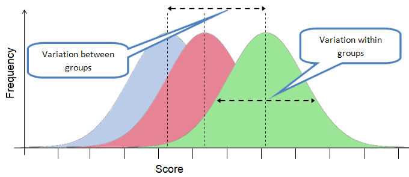
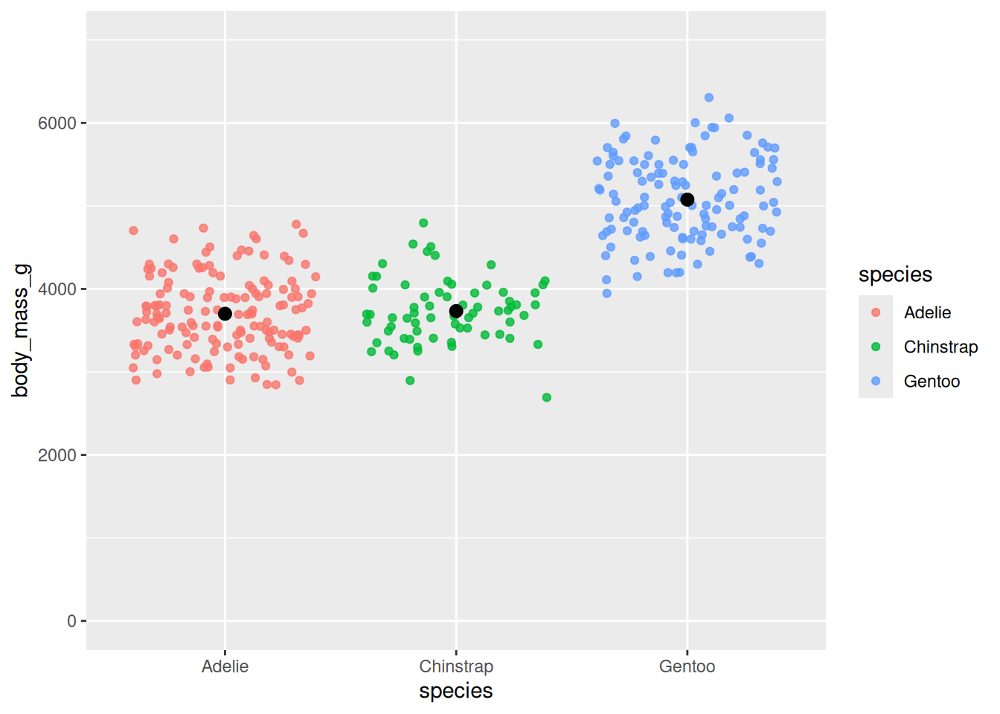
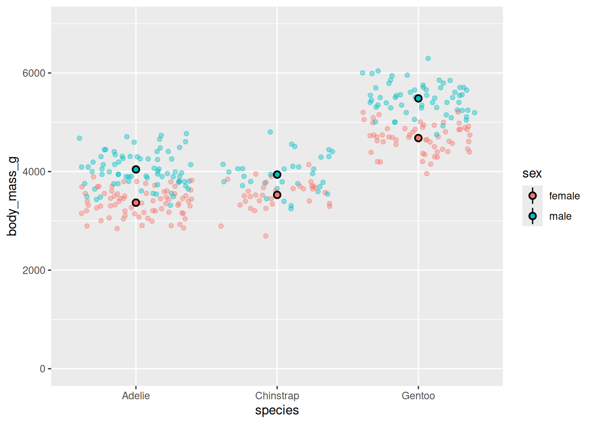
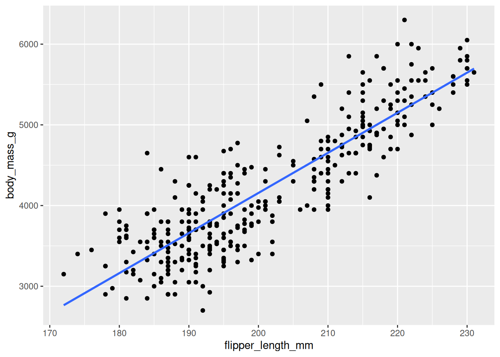
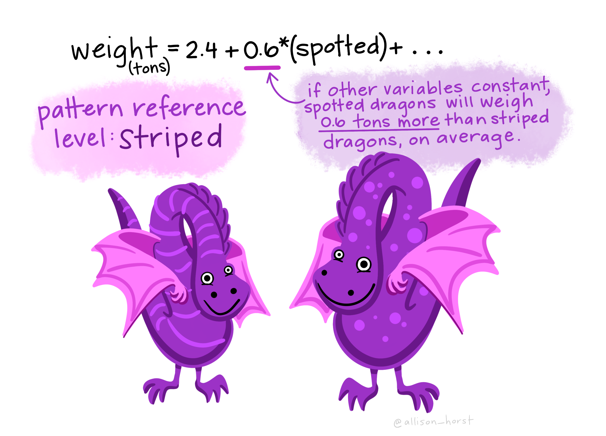

# Statistics with More Than Two Variables


Sometimes you will need to perform statistical tests on more than two variables, or with more than two categorical groups. This chapter covers two tests you can use in this situation: ANOVA and regression.

## ANOVA

ANOVA stands for **an**alysis **o**f **va**riance. What does that means? It means we are interested in comparing the variance *within* a group compared to the variance *between* groups. Conceptually, if the variance between groups is larger than within each group, this would indicate a significant differnce between groups.

{width=100%}
*https://shire.science.uq.edu.au/CONS7008/_book/linear-models---analysis-of-variance-anova.html*

Referring back to the "choosing a test" infographic, an ANOVA is the test to use when you have a  **continuous outcome** AND a **categorical predictor** with more than 2 groups (one-way ANOVA) or more than 1 categorical predictor (two-way ANOVA). It's essentially an extension of a t-test to more groups.

### One-way ANOVA

A one-way ANOVA involves just two variables, a continuous outcome and a categorical predictor, but the predictor has more than two groups so you can't use a t-test. For more information, see [LSWR](https://learningstatisticswithr.com/14-anova.html).

Our example research question will be: "is there a difference in body mass by penguin species?" The null hypothesis is no difference and the alternative hypothesis is that there is a difference (non-directional).


``` r
penguins %>%
  ggplot(aes(y = body_mass_g, x = species)) + 
  geom_jitter(aes(color = species), alpha = .8) +
  stat_summary(fun.data = "mean_se", geom = "pointrange") +
  coord_cartesian(ylim = c(0,7000))
```



Looks like Gentoo penguins weigh the most, on average. Let's test it!

#### Calculating the test in R

To calculate an ANOVA in R, we will use the `aov()` function with a formula input. In this formula, `~` means **"group by"**. So y ~ x is equivalent to y grouped by x, or body mass grouped by species. Or another way to think about it is that y is the outcome and x is the predictor, so y ~ x means x predicting y.


``` r
aov(formula = body_mass_g ~ species, 
    data = penguins)
#> Call:
#>    aov(formula = body_mass_g ~ species, data = penguins)
#> 
#> Terms:
#>                   species Residuals
#> Sum of Squares  146864214  72443483
#> Deg. of Freedom         2       339
#> 
#> Residual standard error: 462.2744
#> Estimated effects may be unbalanced
#> 2 observations deleted due to missingness
```

Hold on, this doesn't give us a p-value! Like the correlation test, this doesn't immediately calculate a hypothesis test. To do that, we need to use the `summary()` function.


``` r
anova_mass <- aov(formula = body_mass_g ~ species, 
    data = penguins)

summary(anova_mass)
#>              Df    Sum Sq  Mean Sq F value Pr(>F)    
#> species       2 146864214 73432107   343.6 <2e-16 ***
#> Residuals   339  72443483   213698                   
#> ---
#> Signif. codes:  
#> 0 '***' 0.001 '**' 0.01 '*' 0.05 '.' 0.1 ' ' 1
#> 2 observations deleted due to missingness
```

There we go!

#### Interpreting the test

Like the other tests we've discussed, there are three numbers we care about: test statistic, degrees of freedom, and p-value.

The ***test statistic*** for an ANOVA is called an F-value (the 4th column in the output table above). As with the other test statistics we've reviewed, higher values usually mean larger differences between groups, and a higher likelihood that the null hypothesis is not supported.

There are two ***degrees of freedom*** values (Df, first column) we care about here: the between group degrees of freedom (related to number of groups, top Df value = 2) and within group degrees of freedom (related to number of observations, bottom Df value = 339).

We interpret the ***p-value*** here (labelled Pr(>F), last column) like in the other tests, comparing it to p = 0.05. In this case, p < 0.0001, so this result is significant. We reject the null and accept the alternative hypothesis that there is a difference in body mass between species.

However, that doesn't tell us about the *direction* of the difference. In the graph above, it looks like Gentoo penguins weigh more than Adelie and Chinstrap penguins, which maybe aren't different from each other. How do we test to see if those are reliable differences between individual groups (or not)? We use a **post hoc test** (post-hoc meaning "after this").

##### Post hoc test
For a one-way ANOVA, the post hoc test is a pairwise t-test: essentially running a t-test for each between group comparison. However, running multiple tests at once inflates the likelihood of getting a significant result, so we need to adjust our p-value using a "correction" method. In this class we will use the Bonferroni correction, but see [LWSR](https://learningstatisticswithr.com/14-anova.html#corrections-for-multiple-testing) for more options and explanation.


``` r
pairwise.t.test(
  x = penguins$body_mass_g, # outcome variable
  g = penguins$species,      # grouping variable
  p.adjust.method = "bonferroni"  # which correction to use?
)
#> 
#> 	Pairwise comparisons using t tests with pooled SD 
#> 
#> data:  penguins$body_mass_g and penguins$species 
#> 
#>           Adelie Chinstrap
#> Chinstrap 1      -        
#> Gentoo    <2e-16 <2e-16   
#> 
#> P value adjustment method: bonferroni
```

This gives us a table of p-values for each test. As you can see, there is a significant difference between average body mass between Adelie and Gentoo penguins (p < 0.0001) and Chinstrap and Gentoo penguins (p < 0.0001). But there is no significant difference between Adelie and Chinstrap penguins in average body mass (p = 1). A table of means is also helpful for interpreting and reporting these results


``` r
penguins %>%
  group_by(species) %>%
  summarize(mean = mean(body_mass_g, na.rm = T))
#> # A tibble: 3 × 2
#>   species    mean
#>   <fct>     <dbl>
#> 1 Adelie    3701.
#> 2 Chinstrap 3733.
#> 3 Gentoo    5076.
```

#### Reporting the test

To report the statistical output of a one-way ANOVA, you can say: "We found a significant overall effect of X, (*F*(a,b)=c, *p*=d)."

* X: Independent variable
* a: DF for groups (predictor)
* b: DF for observations (residuals)
* c: *F*-value for the effect
* d: *p*-value for the effect

For example, you can report the ANOVA above like this (using both the post hoc t-test and means to report between group differences):

:::{.rmdimportant}
"We ran a one-way ANOVA of penguin species on body mass. We observed a significant overall effect of Species (*F*(2,339) = 343.6, *p* < 0.0001). On average, body mass was larger for Gentoo penguins (mean = 5076 g) compared to both Adelie penguins (mean = 3701 g, *p* < 0.001) and Chinstrap penguins (mean = 3733 g, *p* < 0.001). Adelie and Chinstrap penguins did not show a significant difference from each other in average body mass (*p* = 1)."
:::

### Two-way ANOVA (factorial)

A two-way, or factorial, ANOVA, involves 2 categorical variables and 1 continuous outcome. This test is commonly used by psychologists using a 2 x 2 group research design. To learn more about factorial ANOVAs, see [LWSR](https://learningstatisticswithr.com/16-anova2.html).

For this test, we will use an extension of the one-way ANOVA research question, just adding in sex as another predictor. So the research question is: "is there a difference in body mass by penguin species and sex?" The null hypothesis is no difference in mean body mass between groups by sex or species and the alternative hypothesis is that there is a difference (non-directional).


``` r
penguins %>%
  filter(!is.na(sex)) %>%
  ggplot(aes(y = body_mass_g, x = species, color = sex, fill = sex)) + 
  geom_jitter(alpha = .4) +
  stat_summary(fun.data = "mean_se", geom = "pointrange", color = "black", shape = 21) +
  coord_cartesian(ylim = c(0,7000))
```



#### Calculating the test in R

To calculate a two-way ANOVA, we can actually use the same test as a one-away ANOVA above. All we have to do is add "sex" onto our formula.


``` r
anova_species_sex <- aov(formula = body_mass_g ~ species + sex, 
    data = penguins)

summary(anova_species_sex)
#>              Df    Sum Sq  Mean Sq F value Pr(>F)    
#> species       2 145190219 72595110   724.2 <2e-16 ***
#> sex           1  37090262 37090262   370.0 <2e-16 ***
#> Residuals   329  32979185   100241                   
#> ---
#> Signif. codes:  
#> 0 '***' 0.001 '**' 0.01 '*' 0.05 '.' 0.1 ' ' 1
#> 11 observations deleted due to missingness
```

Notice the output of this test gives me an *F*-value and *p*-value for both species and sex, but it doesn't tell me if there is an **interaction** between the two. That is, whether there is a larger difference in body mass between male and female Gentoo penguins compared to the difference between male and female Chinstrap penguins. I'm not going to cover interactions in this class, but if you are interested in learning more or using an interaction in your project see [LWSR](https://learningstatisticswithr.com/16-anova2.html#fig-interaction-2). If you wanted to specify an interaction in the model, you can just replace the `+` between the predictors with a `*`

#### Interpreting the test

Interpreting a two-way ANOVA is very similar to a one-way ANOVA, just that you have two sets of *F*-values, DFs, and *p*-values, one for each predictor. So I would examine the *p*-value of the `species` row to determine that there is a significant difference in body mass by species (p < 0.0001), and the `sex` row for the significant difference based on sex (p < 0.0001).

Another important difference is that, in a two-way ANOVA, the relationship between each predictor and the outcome now ***accounts*** for the other predictor. That is, the *F*-value of species in this analysis is NOT the same as in the one-way ANOVA above. We will talk about this more when we discuss multiple regression below.

Just as in the one-way ANOVA however, these overall or "omnibus" *F*-values do not tell us if there is a significant difference between groups and, if so, what that difference is. For that, we need a post-hoc test.

##### Post hoc test

Unfortunately, we can't conduct a series of paiwise t-tests to look at differences in this case, because that test cannot control for multiple predictor variables. Instead, we will use a statistical technique aptly named Tukey's "Honestly Significant Difference" test, known as a **Tukey's HSD**.


``` r
TukeyHSD(anova_species_sex)
#>   Tukey multiple comparisons of means
#>     95% family-wise confidence level
#> 
#> Fit: aov(formula = body_mass_g ~ species + sex, data = penguins)
#> 
#> $species
#>                        diff        lwr      upr     p adj
#> Chinstrap-Adelie   26.92385  -82.51532  136.363 0.8313289
#> Gentoo-Adelie    1386.27259 1294.21284 1478.332 0.0000000
#> Gentoo-Chinstrap 1359.34874 1246.03315 1472.664 0.0000000
#> 
#> $sex
#>                 diff     lwr      upr p adj
#> male-female 667.4577 599.193 735.7224     0
```

A Tukey's HSD essentially constructs multiple 95% confidence intervals (significance thresholds) to examine differences between all groups simultaneously. As you can see, this gives us adjusted p-values, like the pairwise t-tests, which correct for multiple comparisons. As we'd expect from previous tests, there are very low *p*-values for Gentoo compared to other species and for male penguins compared to females.

We can also calculate means for each group to help us interpret the differences.

``` r
penguins %>%
  group_by(species) %>%
  summarize(mean = mean(body_mass_g, na.rm = T))
#> # A tibble: 3 × 2
#>   species    mean
#>   <fct>     <dbl>
#> 1 Adelie    3701.
#> 2 Chinstrap 3733.
#> 3 Gentoo    5076.

penguins %>%
  filter(!is.na(sex)) %>%
  group_by(sex) %>%
  summarize(mean = mean(body_mass_g, na.rm = T))
#> # A tibble: 2 × 2
#>   sex     mean
#>   <fct>  <dbl>
#> 1 female 3862.
#> 2 male   4546.
```

Note that we can't group by species and sex at the same time, because that would give us an interaction between to predictors (Adelie females vs. Chinstrap females) instead of overall differences by predictor (males vs. females).

#### Reporting the test

To report the statistical results of a two-way ANOVA, you can say: "We found a significant main effect of {X or Y} on outcome, (*F*(a,b)=c, *p*=d)."

* X, Y: Independent variables for which you observe significant effects
* a: DF group for the variable involved in the effect
* b: DF observations (residuals)
* c: *F*-value for the effect
* d: *p*-value for the effect

:::{.rmdimportant}
"We ran a 2 (Sex) x 3 (Species) ANOVA on body mass. We observed significant main effects of Species, (*F*(2,329) = 724.2, *p* < 0.0001) and Sex (*F*(1,329) = 370.0, *p* < 0.0001) and used a Tukey's HSD to conduct post hoc analyses. For sex, body mass was larger on average for male penguins (mean = 4546 grams) than female penguins (mean = 3862 grams, p < 0.0001). For species, body mass was larger on average for Gentoo penguins (mean = 5076 g) compared to Adelie penguins (mean = 3701 g, *p* < 0.001) and Chinstrap penguins (mean = 3733 g, *p* < 0.001). Adelie and Chinstrap penguins did not show a significant difference in average body mass (*p* = 1)."
:::

## Regression

Regression is probably the most powerful statistical tool that we will discuss in this class. That's because you can use it in so many different analyses. Also because it tells us something we want to know: how much does our predictor tell us about our outcome variable?

We can get a sense for how regressions work by looking at the trendline we've used in our graphs.


``` r
penguins %>%
  ggplot(aes(y = body_mass_g, x = flipper_length_mm)) +
  geom_point() +
  geom_smooth(method = 'lm', se = FALSE)
```



This trendline is actually a regression line. It tells us, "how well do our x-values allow us to predict our y-values"? In this graph, how well does flipper length predict body mass?

To answer this question, the regression calculates a ***line of best fit*** that tries to minimize the distance from the line to each dot (or observation; also called the "ordinary least squares" or OLS method, there are others). From that, we can express that relationship with numbers using a very basic formula for a line:
$$y = mx + b$$

Where *m* is the slope of the line (change in y/change in x) and *b* is the y-intercept (the value of y when x = 0). *(The actual regression formula is a little bit more complicated, but not much, see [LSWR](https://learningstatisticswithr.com/15-regression.html#sec-introregression).)* The value we care most about here is the slope, because that tells us about the relationship between x and y.

For our purposes in this class, there are two cool things that regressions allow us to do:

* **Cool thing #1**: Examine how much change in one variable we should expect, given a change in the other (e.g., what change in y given a 1 unit change in x?).

* **Cool thing #2**: Determine how well the predictor(s) in our regression predict the outcome. How well does our line actually fit the data?

### Simple regression

A simple regression takes the same variables as a correlation: a continuous outcome and continuous predictor. The difference from a correlation is that a regression assumes a ***directional*** relationship between the two variables: we should have reason to expect that the predictor *predicts* or maybe even causes the outcome, not the other way around. However, we won't worry about that too much for our examples here.

#### Calculating the test in R

We will use the `lm()` function to create a regression model in R (model just means equation here). Like an ANOVA, we use a formula input.


``` r
lm(formula = body_mass_g ~ flipper_length_mm,
   data = penguins)
#> 
#> Call:
#> lm(formula = body_mass_g ~ flipper_length_mm, data = penguins)
#> 
#> Coefficients:
#>       (Intercept)  flipper_length_mm  
#>          -5780.83              49.69
```

The `coefficients` here relate to the *m* and *b* in our line equation above. The first one is the y-intercept (helpfully labelled "(Intercept)") and the second one is the slope of the relationship between body mass and flipper length (labelled with the variable name, "flipper_length_mm").

You can interpret the flipper length coefficient by saying that for every 1 mm change in flipper length there is an average change of ~50 g in body mass.

However, this output does not conduct a hypothesis test or provide a *p*-value. Again, to do that we'll need to use `summary()`. Before we do that, let's think about the null and alternative hypothesis in this test.

* **Null hypothesis**: There is NO relationship between body mass and flipper length (slope = 0).
* **Alternative hypothesis**: There IS a relationship between body mass and flipper length (slope ≠ 0).


``` r
reg_flipper_mass <- lm(formula = body_mass_g ~ flipper_length_mm,
   data = penguins)

summary(reg_flipper_mass)
#> 
#> Call:
#> lm(formula = body_mass_g ~ flipper_length_mm, data = penguins)
#> 
#> Residuals:
#>      Min       1Q   Median       3Q      Max 
#> -1058.80  -259.27   -26.88   247.33  1288.69 
#> 
#> Coefficients:
#>                    Estimate Std. Error t value Pr(>|t|)    
#> (Intercept)       -5780.831    305.815  -18.90   <2e-16 ***
#> flipper_length_mm    49.686      1.518   32.72   <2e-16 ***
#> ---
#> Signif. codes:  
#> 0 '***' 0.001 '**' 0.01 '*' 0.05 '.' 0.1 ' ' 1
#> 
#> Residual standard error: 394.3 on 340 degrees of freedom
#>   (2 observations deleted due to missingness)
#> Multiple R-squared:  0.759,	Adjusted R-squared:  0.7583 
#> F-statistic:  1071 on 1 and 340 DF,  p-value: < 2.2e-16
```

#### Interpreting the test

There's a lot of information in the output, but for our purposes we can ignore some of it. We want to focus on the coefficients table, R-squared values, F-statistic, and DF values.

##### Coefficients

The first part we can interpret is the ***Estimate*** column, specifically for the estimate next to our variable of interest, `flipper_length_mm`. You'll notice this is the same number as in our simple `lm()` function output above. Again, this is the slope of the line, or the relationship between change in x (flipper length) and change in y (body mass). This "raw" slope is called a B weight or **unstandardized** regression coefficient. We could also create a **standardized** regression coefficient or $\beta$ (beta) weight by controlling for the standard deviation of our predictor and outcome (z-score; see [LSWR](https://learningstatisticswithr.com/15-regression.html#sec-regressioncoefs)). $\beta$ weights are more helpful for multiple regression to allow for a standard interpretation across multiple predictors, so we will discuss it more below.

We have some additional outputs beyond the coefficients: **St**andar**d** **Error**, **t value**, and the last column Pr(>|t|), which is actually our **p value**. We can interpret this *p*-value like the other ones, by comparing to p = 0.05. In this case, *p* > 0.0001, so we can conclude that there is a significant relationship between body mass and flipper length. That is, the relationship between them is significantly different from 0.

##### F-value

Interestingly, you'll notice at the very bottom of the output there is an "F-statistic". It turns out, this is the same *F*-value we discussed in the ANOVA section above! ANOVA and regression are pretty much the same math on the back-end (at least in R), so the *F*-value here gives us the overall fit along with the R-squared value. In this case, the *F*-value is 1071 and the related *p*-value (also on the bottom line of the output) is > 0.0001, so the overall model fit is also statistically significant (different from *F*-value = 0). The relevant degrees of freedom are also in this bottom row.

##### R-squared

There is an additional important output here: ***R-squared*** or $R^2$. $R^2$ allows us to do cool thing #2: say something about how well x predicts y. Yes, the relationship is different from 0, but **how much** of the variability in y can we predict from changes in x? *(Note: In this class, we will use the "Multiple R-squared" output, not the "adjusted R-squared".)*

For this test, $R^2$ = 0.759. In other words, 75.9% of the variance in body mass can be explained by flipper length. That's pretty good! In contrast, compare this to the relationship between body mass and bill depth.


``` r
reg_depth_mass <- lm(body_mass_g ~ bill_depth_mm, penguins)

summary(reg_depth_mass)
#> 
#> Call:
#> lm(formula = body_mass_g ~ bill_depth_mm, data = penguins)
#> 
#> Residuals:
#>      Min       1Q   Median       3Q      Max 
#> -1607.38  -510.10   -66.96   462.43  1819.28 
#> 
#> Coefficients:
#>               Estimate Std. Error t value Pr(>|t|)    
#> (Intercept)    7488.65     335.22   22.34   <2e-16 ***
#> bill_depth_mm  -191.64      19.42   -9.87   <2e-16 ***
#> ---
#> Signif. codes:  
#> 0 '***' 0.001 '**' 0.01 '*' 0.05 '.' 0.1 ' ' 1
#> 
#> Residual standard error: 708.1 on 340 degrees of freedom
#>   (2 observations deleted due to missingness)
#> Multiple R-squared:  0.2227,	Adjusted R-squared:  0.2204 
#> F-statistic: 97.41 on 1 and 340 DF,  p-value: < 2.2e-16
```

Bill depth is still a significant predictor of body mass (p < 0.0001), but the $R^2$ is significantly lower at 0.22. So bill depth explains only 22% of the variability in body mass. In this data, flipper length is a better predictor (more closely related to) body mass than bill depth.

#### Reporting the test

Reporting a regression is slightly more complicated than other tests because we actually need to report two different things: 1) the fit of the overall model and 2) the coefficient for our predictor. So prepare yourself for a long list of values!

To report the statistical output of a simple regression, you can say: "We found that our overall regression model was [not] significant ($R^2$=z, *F*(a,b)=c, *p*=d). X [did not] significantly predict[ed]  Y (B=e, *p*=f)."

* X: Predictor (Independent variable)
* Y: Outcome (Dependent variable)
* z: Multiple R-squared output
* a: 1st DF for overall model (groups, smaller DF number)
* b: 2nd DF for overall model (observations, larger DF number)
* c: *F*-value for the overall model
* d: *p*-value for the overall model
* e: coefficient estimate for X
* f: *p*-value for coefficient estimate (B) of X

:::{.rmdimportant}
"We conducted a simple linear regression to test if a penguin's flipper length predicted their body mass. We found that our overall regression model was significant, such that flipper length explained 75.9% of the variance in body mass ($R^2$ = 0.759, *F*(1,340) = 1071, *p* < 0.0001). Flipper length significantly predicted body mass (B = 49.69, *p* < 0.0001). [optional] For every 1 mm change in flipper length there was, an average, a change of ~50 g in body mass."
:::

### Multiple regression

Multiple regression is just a regression with **multiple** predictors, like a two-way ANOVA.

#### Calculating the test in R

For our example, we can just add another predictor, bill depth, to our existing simple regression.


``` r
reg_flipper_mass_depth <- lm(formula = body_mass_g ~ 
                               flipper_length_mm + 
                               bill_depth_mm,
   data = penguins)

summary(reg_flipper_mass_depth)
#> 
#> Call:
#> lm(formula = body_mass_g ~ flipper_length_mm + bill_depth_mm, 
#>     data = penguins)
#> 
#> Residuals:
#>      Min       1Q   Median       3Q      Max 
#> -1029.78  -271.45   -23.58   245.15  1275.97 
#> 
#> Coefficients:
#>                    Estimate Std. Error t value Pr(>|t|)    
#> (Intercept)       -6541.907    540.751 -12.098   <2e-16 ***
#> flipper_length_mm    51.541      1.865  27.635   <2e-16 ***
#> bill_depth_mm        22.634     13.280   1.704   0.0892 .  
#> ---
#> Signif. codes:  
#> 0 '***' 0.001 '**' 0.01 '*' 0.05 '.' 0.1 ' ' 1
#> 
#> Residual standard error: 393.2 on 339 degrees of freedom
#>   (2 observations deleted due to missingness)
#> Multiple R-squared:  0.761,	Adjusted R-squared:  0.7596 
#> F-statistic: 539.8 on 2 and 339 DF,  p-value: < 2.2e-16
```

#### Interpreting the test

Like a two-way ANOVA, adding another predictor changes the way that we interpret the results. Now, the overall model fit depends on two variables, not just one. And the coefficient estimates or B weights for each predictor are **controlling** for the other predictors, they are not just the simple relationship between predictor and outcome. 

For example, to interpret the B weight for flipper length in this model, you would say that for every 1 unit increase in flipper length there is a ~51 g change in body mass ***if bill depth is held constant***. You'll notice this is a slightly different number than in the simple regression; this is a result of including multiple predictors, even if bill depth is not a significant predictor.

A final note on interpreting multiple regressions: so far we have used B weights, or unstandardized regression coefficients. These are useful because they can be interpreted in the original units (mm and grams). However, if our predictors were in different units (let's say mm and inches), we could not easily compare them. Instead, we would want to use standardized regression coefficients, called $\beta$ weights.

The easiest way to calculate standardized coefficients in R is just to add the `scale()` function to our regression model, which standardizes the values.


``` r
reg_flipper_mass_depth_std <- lm(formula = scale(body_mass_g) ~ 
                                   scale(flipper_length_mm) + 
                                   scale(bill_depth_mm),
   data = penguins)

summary(reg_flipper_mass_depth_std)
#> 
#> Call:
#> lm(formula = scale(body_mass_g) ~ scale(flipper_length_mm) + 
#>     scale(bill_depth_mm), data = penguins)
#> 
#> Residuals:
#>      Min       1Q   Median       3Q      Max 
#> -1.28408 -0.33849 -0.02941  0.30569  1.59107 
#> 
#> Coefficients:
#>                           Estimate Std. Error t value
#> (Intercept)              8.502e-16  2.651e-02   0.000
#> scale(flipper_length_mm) 9.037e-01  3.270e-02  27.635
#> scale(bill_depth_mm)     5.574e-02  3.270e-02   1.704
#>                          Pr(>|t|)    
#> (Intercept)                1.0000    
#> scale(flipper_length_mm)   <2e-16 ***
#> scale(bill_depth_mm)       0.0892 .  
#> ---
#> Signif. codes:  
#> 0 '***' 0.001 '**' 0.01 '*' 0.05 '.' 0.1 ' ' 1
#> 
#> Residual standard error: 0.4903 on 339 degrees of freedom
#>   (2 observations deleted due to missingness)
#> Multiple R-squared:  0.761,	Adjusted R-squared:  0.7596 
#> F-statistic: 539.8 on 2 and 339 DF,  p-value: < 2.2e-16
```

The only change here is the coefficient estimates and std. error. We would interpret these coefficients in terms of standard deviation units. For example, "Flipper length significantly predicted body mass ($\beta$ = 0.90, p < 0.0001), controlling for bill depth. For every 1 unit change in flipper length there was a 0.9 unit change in body mass, standardized across units, when bill depth remained constant."

For the purposes of class assignments, we will focus on reporting and interpreting unstandardized coefficients (B weights), but you are welcome to use standardized coefficients in your project if it makes sense for your research question and/or analysis.

#### Reporting the test

To we report the multiple regression output with unstandardized coefficients, we could say: "We found that our overall regression model was [not] significant ($R^2$=z, *F*(a,b)=c, *p*=d). X [did not] significantly predict[ed]  Y (B=e, *p*=f). W also [did not] significantly predict[ed] Y  (B=g, *p*=h)."

* X: Predictor 1 (Independent variable)
* W: Predictor 2 (Independent variable)
* Y: Outcome (Dependent variable)
* z: Multiple R-squared output
* a: 1st DF for overall model (groups, smaller DF number)
* b: 2nd DF for overall model (observations, larger DF number)
* c: *F*-value for the overall model
* d: *p*-value for the overall model
* e: coefficient estimate for X
* f: *p*-value for coefficient estimate (B) of X
* g: coefficient estimate for W
* h: *p*-value for coefficient estimate (B) of W

:::{.rmdimportant}
"We conducted a multiple linear regression to test how a penguin's flipper length and bill depth predicted their body mass. We found that our overall regression model was significant, such that both predictors explained 76.1% of the variance in body mass ($R^2$ = 0.761, *F*(2,339) = 539.8, *p* < 0.0001). When looking at each predictor controlling for the other, flipper length significantly predicted body mass (B = 51.5, *p* < 0.0001), while bill depth did not (B = 22.6, *p* = 0.089). "
:::

### Categorical variables in regression

So far, we've been talking about regression models only in terms of continuous predictors and outcomes. Well, one of the things that makes regression such a powerful statistical too is that you can actually use it with categorical variables as well!

{width=100%}
Illustration by [@allison_horst](https://www.allisonhorst.com/)

#### Categorical predictors

Let's say that we want to look at how both flipper length AND sex of the penguin is related to body mass.


``` r
penguins_noNA <- penguins %>%
  filter(!is.na(sex))

reg_flipper_mass_sex <- lm(formula = body_mass_g ~ flipper_length_mm + sex,
   data = penguins_noNA)

summary(reg_flipper_mass_sex)
#> 
#> Call:
#> lm(formula = body_mass_g ~ flipper_length_mm + sex, data = penguins_noNA)
#> 
#> Residuals:
#>     Min      1Q  Median      3Q     Max 
#> -910.28 -243.89   -2.94  238.85 1067.73 
#> 
#> Coefficients:
#>                    Estimate Std. Error t value Pr(>|t|)    
#> (Intercept)       -5410.300    285.798 -18.931  < 2e-16 ***
#> flipper_length_mm    46.982      1.441  32.598  < 2e-16 ***
#> sexmale             347.850     40.342   8.623 2.78e-16 ***
#> ---
#> Signif. codes:  
#> 0 '***' 0.001 '**' 0.01 '*' 0.05 '.' 0.1 ' ' 1
#> 
#> Residual standard error: 355.9 on 330 degrees of freedom
#> Multiple R-squared:  0.8058,	Adjusted R-squared:  0.8047 
#> F-statistic: 684.8 on 2 and 330 DF,  p-value: < 2.2e-16
```

This output looks very similar to the multiple regression with bill depth above. However, in this case, you'll notice that the third row in the coefficients table is labeled "sexmale". This is the coefficient for specifically male penguins, that is, that body mass is 347.9 g higher for a male penguin (rather than female). If we wanted the coefficient in terms of female penguins, we would need to specify "male" as the comparison group instead of "female" using the `relevel()` function before running the regression.


``` r
penguins_noNA$sex <- relevel(penguins_noNA$sex, ref = "male")

reg_flipper_mass_sex <- lm(formula = body_mass_g ~ flipper_length_mm + sex,
   data = penguins_noNA)

summary(reg_flipper_mass_sex)
#> 
#> Call:
#> lm(formula = body_mass_g ~ flipper_length_mm + sex, data = penguins_noNA)
#> 
#> Residuals:
#>     Min      1Q  Median      3Q     Max 
#> -910.28 -243.89   -2.94  238.85 1067.73 
#> 
#> Coefficients:
#>                    Estimate Std. Error t value Pr(>|t|)    
#> (Intercept)       -5062.450    296.022 -17.102  < 2e-16 ***
#> flipper_length_mm    46.982      1.441  32.598  < 2e-16 ***
#> sexfemale          -347.850     40.342  -8.623 2.78e-16 ***
#> ---
#> Signif. codes:  
#> 0 '***' 0.001 '**' 0.01 '*' 0.05 '.' 0.1 ' ' 1
#> 
#> Residual standard error: 355.9 on 330 degrees of freedom
#> Multiple R-squared:  0.8058,	Adjusted R-squared:  0.8047 
#> F-statistic: 684.8 on 2 and 330 DF,  p-value: < 2.2e-16
```

Now male is baseline or comparison group, and the coefficient tells us that the body mass of a female penguin is -347.9 g compared to a male. With two groups in the categorical variable, the difference between the two is just a negative sign.

These regressions with a categorical variable with two groups can be interpreted and reported in very similarly to a multiple regression with continuous predictors.

:::{.rmdimportant}
"We conducted a multiple linear regression to test how a penguin's flipper length and sex predicted their body mass. We found that our overall regression model was significant, such that both predictors explained 80.6% of the variance in body mass ($R^2$ = 0.806, *F*(2,330) = 684.8, *p* < 0.0001). When looking at each predictor controlling for the other, flipper length significantly predicted body mass (B = 46.98, *p* < 0.0001) and male penguins had significantly higher body mass than female penguins (B = 347.9, *p* < 0.0001)."
:::

You can also extend this approach, which is called "dummy coding" to categorical variables with [more than two groups](https://www.datanovia.com/learn/biostatistics/regression/regression-with-categorical-variables-in-r). There are also [other ways](https://stats.oarc.ucla.edu/spss/faq/coding-systems-for-categorical-variables-in-regression-analysis-2/) to handle categorical variables in regressions that are beyond the scope of this class.

#### Categorical outcome (Logistic regression)

You can also calculate regressions with binary (2 group) categorical ***outcomes***, called logistic or logit regression. This analysis goes beyond the scope of most introductory statistics classes in psychology, so I won't cover it here. But if you want to learn more or use it in your project, there are some overviews in [UCLA's OARC stats guide](https://stats.oarc.ucla.edu/r/dae/logit-regression/), [GeeksForGeeks](https://www.geeksforgeeks.org/r-language/logistic-regression-in-r-programming/), and [Datanovia](https://www.datanovia.com/learn/biostatistics/regression/logistic-regression-in-r) (the people who made `rstatix`).
