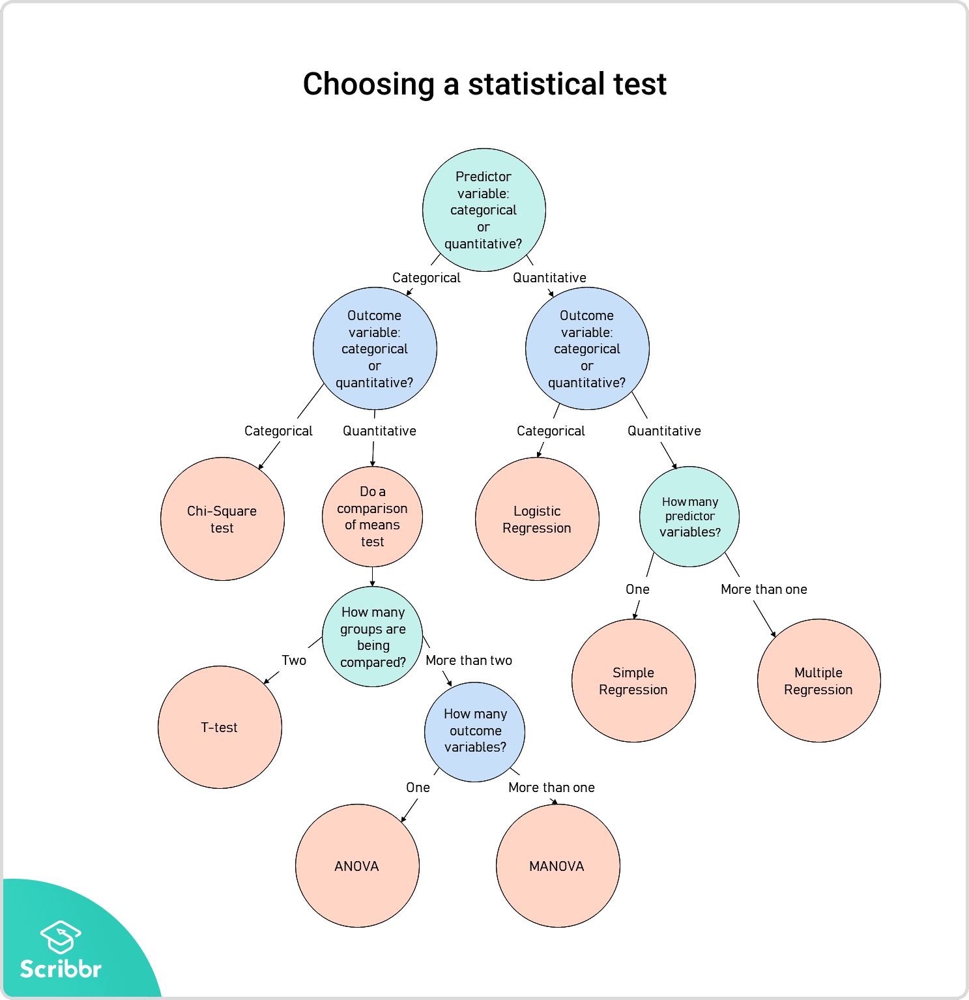
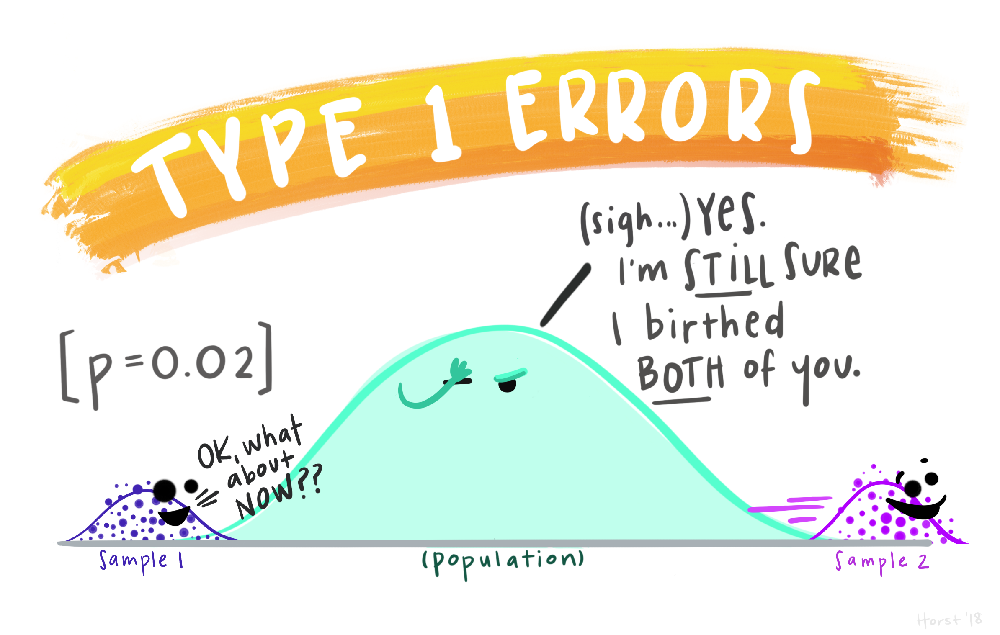
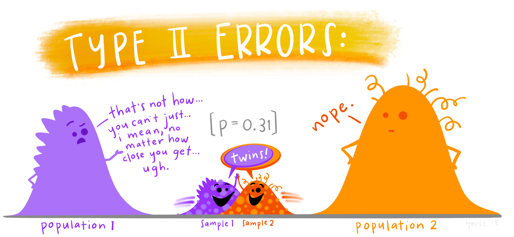
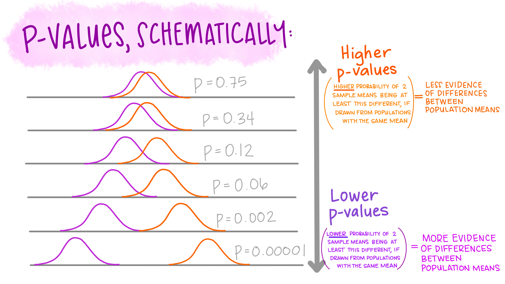
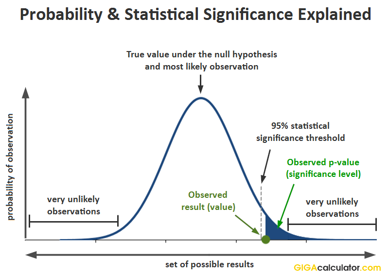

---
output:
  pdf_document: default
  html_document: default
---

# (PART\*) Statistics in R {-}

```{r setup, include=FALSE}
knitr::opts_chunk$set(strip.white = TRUE)
```

```{r echo = FALSE, message=FALSE, warning=FALSE}
library(kableExtra)
library(knitr)
library(palmerpenguins)
library(tidyverse)
```

# Statistics: A Review

Statistics. For some psych majors, their best friend. For some, their worst enemy. I didn't feel like I understood statistics until I started using it to analyze real-world datasets. So I hope this class helps you understand it better too!

In this class, we will **not** focus on the math behind statistical tests (you already learned that in PSY 210). Instead, we will focus on how to understand them conceptually, decide which test to apply to different types of data, and how to interpret the results. And of course we will learn how to run statistical tests in R (that's the easy part!). 

::: {.rmdimportant}
This introductory chapter is a review of statistical concepts you learned previously in your stats class. If you feel like you have a good grasp on statistics, feel free to skip to the next chapter, or you can bounce around in this chapter reviewing those concepts that you feel least confident about. Throughout the chapters in this unit, I've included links to a textbook called [Learning Statistics with R (LSWR)](https://learningstatisticswithr.com/) that I recommend and provides a deeper look at these concepts if you want more information or examples.
:::

## Choosing a statistical test

Just like choosing a graph, choosing a statistical test depends on the type of data that you have. That includes whether the data is *categorical* (qualitative, groups) or *continuous* (quantitative, numbers). It also includes which variable is your **predictor** and which is your **outcome**. 

A *predictor*, a.k.a. independent variable, is a variable that you think might impact some variable of interest. For example, if your research question is "How does occupation impact income?", then your predictor in this question is occupation. 

An *outcome*, also known as the dependent variable, is the variable that is impacted by the predictor. For example, income in the question above. That is, a predictor and an outcome have a directional relationship, such that predictor -> outcome, but outcome does not impact the predictor.

Once you have determined your predictor and outcome, and decided if each variable is categorical and continuous, you are ready to choose a statistical test! This process is outlined in the flowchart below.

{width=100%}

### Step 1 - Predictor variable type 
As you can see, you start by determining what kind of predictor variable you have, categorical or continuous. In my example with occupation and income, my predictor would be categorical, because occupations fall into different groups and are not numerical. So I would move down the left arrow with the label "categorical."

### Step 2 - Outcome variable type
Then I would need to determine if my outcome variable is categorical or continuous. In my example, my outcome of income would be continuous or quantitative, because it's a certain amount of money that can be represented with a number. So I would move down the right arrow that reads "quantitative".

### Step 3 - Number of groups (or predictors)
The final step depends on if your predictor is categorical or continuous. With a categorical variable (like occupation), you will need to know how many groups or levels there are in your variable to determine which analysis to do. If there are just two groups, you can do a t-test; for more than two groups, you use an ANOVA (we will talk about these tests more later on).

If your predictor is continuous or quantitative, then the number of groups doesn't matter (or make sense). For example, if my predictor variable was years of education instead of occupation. In this case, the final step is deciding how many predictors you have. If you just have one predictor, you can do a simple regression (or a correlation, if you don't predict a directional relationship - more on that later).  If more than one predictor, it's a multiple regression.

This last step makes it clear that the number of variables you want to analyze helps determine which statistical test you choose. So the next chapter will focus on statistical tests with just two variables and then on tests with more than two variables.

## Hypothesis testing

In psychology, we most often use Null Hypothesis Significance Testing (NHST) to answer our research questions. While there are issues with this approach (see [this section of  LSWR](https://learningstatisticswithr.com/11-hypothesistesting.html#sec-nhstmess) for more information), since this is a data science class, not a statistics class, we will use this approach as you learned it in your Psychological Statistics class.

In NHST, there is always a null hypothesis and an alternative hypothesis. The **null hypothesis** typically expresses that there is no impact of the predictor on the outcome, for example, occupation *does not* impact income. The **alternative hypothesis** expresses that there is an impact of the predictor on the outcome, or occupation *does* impact income. Our goal with our statistical test is to decide if we should accept the null hypothesis (there is no impact), or reject the null hypothesis in favor of the alternative (there is an impact).

To help make this more concrete, think about the question "does a dentist make more money than a university professor, on average?" (In case you're curious, the question is unfortunately yes.) In this case our hypotheses are:

$$H_0: \text{mean dentist income} = \text{mean professor income}$$
That is, the difference between mean dentist income and mean professor income is 0.

$$H_1: \text{mean dentist income} > \text{mean professor income}$$

That is, the difference between mean dentist income and mean professor income is greater than 0.

These hypotheses could be represented with this graph (there are several possible values for H1, I have chosen one):

```{r echo=FALSE}
library(ggplot2)

# Set seed for reproducibility
set.seed(42)

# Define parameters for Null and Alternative distributions
mean_null <- 0
sd_null <- 1

mean_alt <- 3
sd_alt <- 1

# Create a data frame for plotting
x_vals <- seq(-4, 6, length.out = 100)
df <- data.frame(
  x = rep(x_vals, 2),
  density = c(dnorm(x_vals, mean = mean_null, sd = sd_null),
              dnorm(x_vals, mean = mean_alt, sd = sd_alt)),
  Distribution = factor(c(rep("Null (H0)", length(x_vals)), 
                          rep("Alternative (H1)", length(x_vals))))
)

# Plot overlapping distributions
demo_plot <- ggplot(df, aes(x = x, y = density, fill = Distribution, color = Distribution)) +
  geom_line(linewidth = 1) +
  geom_area(position = "identity", alpha = 0.4) +
  labs(
    # title = "Null vs. Alternative Distributions",
    x = "Test Statistic",
    y = "Density"
  ) +
  theme_classic()

demo_plot +
  geom_vline(xintercept = mean_null, linetype = "dashed", color = "blue") +
  geom_vline(xintercept = mean_alt, linetype = "dashed", color = "red") +
  annotate("text", x = mean_null-0.75, y = 0.41, label = "H0 mean", color = "blue") +
  annotate("text", x = mean_alt+0.75, y = 0.41, label = "H1 mean", color = "red")
  
```
<p style="font-size:8pt">Graph created with help from Google Gemini</p>

We'll build on this graph as we continue to review statistical concepts.

Of course, in any given situation, the null hypothesis *might* be true or false. This sets up the 2x2 table below of possible outcomes, depending on if we ***decide*** that the null is true (accept) or false (reject) and if the null is ***actually*** true or false.

```{r echo=FALSE}
df <- data.frame(
  row = c("𝐻0 is true", "𝐻0 is false"),
  h0_true = c("correct decision", "error (type II)"),
  h1_true = c("error (type I)", "correct decision")
)

df %>%
  mutate(
    h0_true = cell_spec(h0_true, color = ifelse(h0_true == "correct decision", "darkgreen", "red")),
    h1_true = cell_spec(h1_true, color = ifelse(h1_true == "correct decision", "darkgreen", "red"))) %>%
  kable(format = "html", col.names = c("","accept 𝐻0", "reject 𝐻0"), escape = F) %>%
  kable_styling(bootstrap_options = c("striped", "hover", "condensed"), full_width = FALSE)
```

So there are two paths to a correct decision: The null hypothesis is true and we accept it, or the null hypothesis is false and we reject it. Two ways to be right is better than one! Unfortunately there are also two ways to be wrong: accept the null when it is false OR reject the null when it is true. 

::: {.rmdimportant}
**Statistical testing (and research design) is all about reducing the likelihood of an error (Type I or Type II), while trying to increase the likelihood of a correct decision! This means you need to choose your testing parameters and cut-offs that balance the likelihood of each error types and might vary depending on which type of error you are more concerned about.**
:::

### Type I Error: False Alarm 

Rejecting the null when it is true is also called a **Type I error or a "false alarm."** *(When your fire alarm goes off as you are making a smoky dinner, this is a Type I error - there isn't a real fire!)* In psychology, we want to avoid a Type I error because we don't want to say an effect is real if it's not. The way to control for a type I error is by setting a lower p-value cut-off (also called an alpha or $\alpha$). We'll talk more about this cut off below.

{width=100%}

<p class="text-info"> **<u>Note:</u> Concern about amount of Type I errors in psychology has increased a lot in the last 15 years, as certain previously established research findings have been shown to not replicate (that is, other researchers couldn't detect the same effect when they did the study again). This issue, and changes to the field of psychology from it, is sometimes called the [Replication Crisis.](https://www.psychologytoday.com/us/basics/replication-crisis)**</p>

### Type II Error: Miss

Accepting the null when it is false is also called a **Type II error or a "miss".** In terms of our concrete example, it would be like saying that dentists and professors make the same amount of money on average, even though they don't! There are some situations where a Type II error matters a lot, like in medical testing. If someone actually has cancer (alternative hypothesis), we don't want to say that they don't have cancer (null hypothesis). So we would to try adjust our testing parameters to reduce the likelihood of a miss.

{width=100%}

We won't talk about it too much in this class, but the way to avoid a type II error is ensure you have enough power in your statistical analysis. This is usually done by increasing your sample size, which is why sample size matters. (See [LSWR on power](https://learningstatisticswithr.com/11-hypothesistesting.html#sec-effectsize) if you want to learn more.)

## Understanding statistical results

So how do we decide whether to accept or reject the null hypothesis, given the problem of Type I and II errors? Well it depends on your **statistical results or outputs**. These results comprise a few numbers, some of which are the same between tests and some of which are different. In this class, you will need to report and interpret these outputs, so I will give an overview of them here and then talk about them more as we review each type of statistical test. 

There are three main statistical outputs you will report from your tests: the 

1) **test statistic**, 
2) **p-value**, and 
3) **degrees of freedom**. 

Some tests have more required outputs to report, but we will talk about those when we get to them. Before we talk about the statistical outputs though, let's review an important concept that will help us understand these values: statistical significance.

### Statistical Signifiance

Statistical significance is something of a holy grail in psychology. Everyone wants statistical significance, because it means that our alternative hypothesis is correct! But sometimes we don't understand it very well. 

The first step to determining statistical significance is setting a cut-off value. You decide this value beforehand, based on how much error you are comfortable with. With this value, you say "if my test statistic is above (and/or below) this value, I will reject the null hypothesis. If not, I will accept the null."

{width=100%}
<p style="font-size:8pt">After we make the decision, this is what we want our professors to say.</p>

The typical statistical significance cut-off value is *p* = 0.05. Although this has been challenged in recent years as part of the Replication Crisis (see [LSWR](https://learningstatisticswithr.com/11-hypothesistesting.html#epilogue-the-world-beyond-p-.05)), this is the cut-off we will use in this class, unless you personally want to use a different one. We'll review p-values in a second, but for now, setting a cut-off of *p* = 0.05 means that you have accepted a 5% chance of a Type I error or false alarm.

To decide where our cut-off value falls in relationship to our data, we calculate **critical values** that represent the statistical significance threshold for our dataset. How we calculate these values depends on what type of test we are doing and whether our alternative hypothesis is directional (greater than or less than the null) or not (just different from the null). In this case, I've calculated it for a two-tailed or non-directional t-test (new lines in purple):

```{r echo = F, message = F, warning = F}

# Set seed for reproducibility
set.seed(42)

# Define parameters for Null and Alternative distributions
mean_null <- 0
sd_null <- 1

mean_alt <- 3
sd_alt <- 1

# Create a data frame for plotting
x_vals <- seq(-4, 6, length.out = 100)
df <- data.frame(
  x = rep(x_vals, 2),
  density = c(dnorm(x_vals, mean = mean_null, sd = sd_null),
              dnorm(x_vals, mean = mean_alt, sd = sd_alt)),
  Distribution = factor(c(rep("Null (H0)", length(x_vals)), 
                          rep("Alternative (H1)", length(x_vals))))
)

# calculate alpha = 0.05
marginal_error = 1.96

demo_plot +
  annotate("segment", x = mean_null, xend = mean_null, y = 0, yend = 0.4, linetype = "dashed", color = "blue") +
  annotate("text", x = mean_null, y = 0.43, label = "H0 mean", color = "blue") +
  
  annotate("segment", x = mean_alt, xend = mean_alt, y = 0, yend = 0.4, linetype = "dashed", color = "red") +
  annotate("text", x = mean_alt, y = 0.43, label = "Observed mean\n(real data)", color = "red") +
  # geom_vline(xintercept = mean_alt, linetype = "dashed", color = "red") +
  
  annotate("segment", x = mean_null - marginal_error, xend = mean_null - marginal_error, y = 0, yend = 0.4, linetype = "solid", color = "purple") +
  
    annotate("segment", x = mean_null + marginal_error, xend = mean_null + marginal_error, y = 0, yend = 0.4, linetype = "solid", color = "purple") +
  annotate("text", x = mean_null - 3, y = 0.3, label = "significance\nthreshold\n(upper and\nlower bound)", color = "purple") +

  theme(legend.position = "none")
```

Based on our cut-off, we would reject the null hypothesis if the mean we observed in our data was outside of the statistical significance threshold (confidence interval). Looking at this graph, it looks like the mean of our data is outside of the bars around the mean of the null. So in this case, we would reject the null hypothesis and accept the alternative hypothesis.

However, if the mean of the observed data fell ***within*** the bars, were would NOT reject the null.

```{r echo = F, message = F, warning = F}

# Set seed for reproducibility
set.seed(42)

# Define parameters for Null and Alternative distributions
mean_null <- 0
sd_null <- 1

mean_alt <- 1.5
sd_alt <- 1

# Create a data frame for plotting
x_vals <- seq(-4, 6, length.out = 100)
df <- data.frame(
  x = rep(x_vals, 2),
  density = c(dnorm(x_vals, mean = mean_null, sd = sd_null),
              dnorm(x_vals, mean = mean_alt, sd = sd_alt)),
  Distribution = factor(c(rep("Null (H0)", length(x_vals)), 
                          rep("Alternative (H1)", length(x_vals))))
)

# calculate alpha = 0.05
marginal_error = 1.96

ggplot(df, aes(x = x, y = density, fill = Distribution, color = Distribution)) +
  geom_line(linewidth = 1) +
  geom_area(position = "identity", alpha = 0.4) +
  labs(
    # title = "Null vs. Alternative Distributions",
    x = "Test Statistic",
    y = "Density"
  ) +
  theme_classic() +
  annotate("segment", x = mean_null, xend = mean_null, y = 0, yend = 0.4, linetype = "dashed", color = "blue") +
  annotate("text", x = mean_null, y = 0.43, label = "H0 mean", color = "blue") +
  
  annotate("segment", x = mean_alt, xend = mean_alt, y = 0, yend = 0.4, linetype = "dashed", color = "red") +
  annotate("text", x = mean_alt, y = 0.43, label = "Observed mean\n(real data)", color = "red") +
  # geom_vline(xintercept = mean_alt, linetype = "dashed", color = "red") +
  
  annotate("segment", x = mean_null - marginal_error, xend = mean_null - marginal_error, y = 0, yend = 0.4, linetype = "solid", color = "purple") +
  
    annotate("segment", x = mean_null + marginal_error, xend = mean_null + marginal_error, y = 0, yend = 0.4, linetype = "solid", color = "purple") +
  annotate("text", x = mean_null - 3, y = 0.3, label = "significance\nthreshold\n(upper and\nlower bound)", color = "purple") +

  theme(legend.position = "none")
```

### Test statistic

This number is the specific output which varies based on the statistical test type, so we will talk about the relevant test statistic for each test as we review them in the next chapters. It is important to report your test statistic, not just your p-value, because it helps your audience understand the size of your effect.

As a simplified overview, for tests with ***categorical variables***, the test statistic is a value that represents where your real data falls along some specific distribution. Calculating this test statistic allows you to compare it to your null hypothesis (usually 0 on the test distribution) to determine statistical significance, whether to accept or reject the null. For example, in a t-test, the test statistic is a t-value; in a chi-square test it is a chi-square value. For tests with ***continuous variables***, it tells you something about the relationship between your variables, like an r-value for a correlation. 

### p-value

The p-value represents the likelihood of getting the results that you got ***if*** the null hypothesis is true. Typically, we want this value to be small because our prediction is usually that the null hypothesis is NOT true. The p-value calculated for your specific dataset is **different** from the p-value cut off (or alpha) that you use to set your statistical significance threshold. The p-value you get from your statistical test is the number that you compare *to* your cut-off to determine statistical significance and whether to accept or reject the null hypothesis. 

So, for example, if your statistical output says that your *p* = 0.01, you would compare this to your cut-off (p = 0.05). Since 0.01 is smaller than 0.05, you would reject the null hypothesis and accept the alternative (that there is a real effect). Remember, *p* = 0.01 means that there is a 1% chance that we got these results given that the null is true. (See [LSWR](https://learningstatisticswithr.com/11-hypothesistesting.html#sec-pvalue) for an alternative, more in-depth explanation.)

::: {.rmdimportant}
**The p-value does NOT represent the probability that the null hypothesis is true!! This is a common misunderstanding so make sure you don't fall into it!**
:::

{width=100%}

If your p-value is less than your cut-off, you would also say that your results are ***statistically significant***. That just means they pass your statistical significance threshold. If the p-value is higher than your cut-off, you would say the results are ***NOT statistically significant***. *(You would not say they are "insignificant"; while this is the opposite of significant, is it not the word people use in statistics.)* If you results are significant, they support your research hypothesis. If they are not significant, they do not support your research hypothesis. In either case, statistics cannot *prove* a hypothesis, it can only support it or not.

{width=100%}
<p style="font-size:8pt">Another depiction of a situation where the p-value is less than the significance threshold.</p>

### Degrees of freedom

The final statistical output you will need to report doesn't seem very important, but it is: degrees of freedom. Unlike the test statistic and p-value, degrees of freedom (or df for short) does not tell us anything about the size of the effect or statistical significance. However, it does tell us something about the sample size (more or less), which, as I said earlier, is important to the chance of a Type II error. Degrees of freedom is simply the number of quantities in your data (like number of participants or groups) minus the number of constraints (typically the number of variables in your analysis minus 1). See [LSWR](https://learningstatisticswithr.com/12-chisquare.html#degrees-of-freedom) for more information. So for example, if you are doing a t-test with two groups and a total sample size of 100 people, you would have 99 degrees of freedom: 100 - 1 (2 groups - 1).

## Reporting a statistical test

After you have run a statistical test, you still need to write it up and report it to your audience (professor, classmates, scientific article readers, etc.). There are four steps to reporting your statistical analysis that we will practice in this class:

**1. Describe the statistical analysis you performed.**

**2. Tell whether the result is statistically significant.**

**3. Present the statistical results or outputs (the test statistic, p-value, degrees of freedom, etc.).**

**4. Describe the relation in the context of your hypothesis and variables.**

For each test that we review, I'll give an example of how to report the results using these 4 steps. For real-world data analysis and reporting, you might need more than these 4 steps, but they are a simple and good place to start.

Ok, that's all for the general review, on to implementing statistical tests in R!

## References
 * This chapter uses examples and code from Learning Statistics with R: https://learningstatisticswithr.com/ 
 * As usual, fun illustrations by [@allison_horst](https://www.allisonhorst.com/)